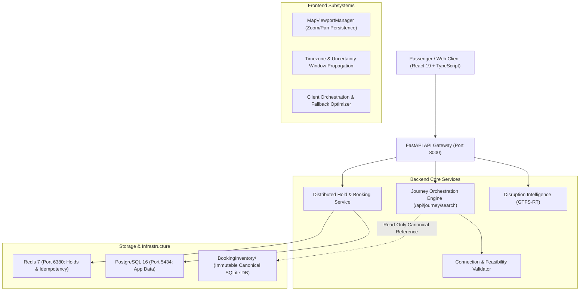

# KogniSync

> **Concurrency-Safe Distributed Booking, Multimodal Journey Orchestration, and Real-Time Transit Feasibility Platform**

[](https://github.com/mad-engineers-hub/KogniSync)
[](https://github.com/mad-engineers-hub/KogniSync)
[](https://github.com/mad-engineers-hub/KogniSync)
[](https://github.com/mad-engineers-hub/KogniSync)

KogniSync is an enterprise-grade multimodal travel planning and distributed booking system designed for high concurrency, real-time disruption resilience, and transparent travel discovery across Indian metropolitan and regional transit corridors.

---

## 🌟 Key Capabilities

- **Distributed Concurrency-Safe Booking Engine:** Distributed temporary holds (TTL-governed), atomic Redis Lua execution, strict database invariants (`booked + held <= total`), idempotency key protection, and saga compensation.
- **Multimodal Journey Orchestration:** Dynamic door-to-door composition spanning walking, EV shuttles, bus lines, metro networks, express trains, and commercial air corridors.
- **Pareto Multi-Objective Optimization:** Evaluates candidate itineraries across cost, travel duration, passenger comfort, and carbon footprint to deliver optimal, non-dominated recommendations.
- **Operational Timetable Integrity:** Anchors scheduled services (e.g. Karnataka Express 12627) to published working timetables, integrating official circulars (SWR PR No. 1404) and propagating arrival uncertainty windows (09:21–10:56 IST).
- **Intelligent Map Viewport Persistence:** Responsive Leaflet maps with `MapViewportManager` preserving user-controlled zoom and pan across background polling, re-renders, and marker updates.
- **Strict Data Credibility & Transparency:** Clearly segregates `provider_live` attributes, `deterministic_estimate` speed/corridor models, and `simulated` test inventories without fabricating ungrounded flight numbers or seat inventory.

---

## 🏗️ Architecture Overview



For comprehensive architectural specifications, refer to:
- 📖 [Comprehensive Architecture Guide](docs/ARCHITECTURE.md)
- 🤝 [Developer Handover & Onboarding Guide](HANDOVER.md)

---

## 🚀 Quick Start

### 1. Prerequisites
- **Node.js**: v20.x or v22.x
- **Python**: v3.11+
- **Docker & Docker Compose**

### 2. Infrastructure Setup
```bash
# Clone the repository
git clone https://github.com/mad-engineers-hub/KogniSync.git
cd KogniSync

# Start PostgreSQL and Redis containers
docker compose up -d
```

### 3. Backend Setup
```bash
cd backend
python -m venv .venv

# Activate virtual environment
# Windows:
.venv\Scripts\Activate.ps1
# Linux/macOS:
source .venv/bin/activate

pip install -r requirements.txt
uvicorn app.main:app --host 0.0.0.0 --port 8000 --reload
```

### 4. Frontend Setup
```bash
cd frontend
npm install
npm run dev
```
Open `http://localhost:5173` in your browser.

---

## 🧪 Verification & Testing

### Backend Tests
```bash
cd backend
pytest tests/test_journey_orchestration.py -v
```

### Frontend Tests & Typecheck
```bash
cd frontend
node scripts/runTests.mjs
npx tsc -b
npm run build
```

---

## 🔒 Canonical Integrity Standard

The directory `BookingInventory/` contains the authoritative organizer dataset and canonical SQLite database (`APS-05.db`). It is **strictly read-only and immutable**.
- **Canonical SHA-256 Checksum:** `F9B4B3185D91649C454BC70214AF83F69BB2D4D7AB7B9C7FB5AF9B900D52B10A`
