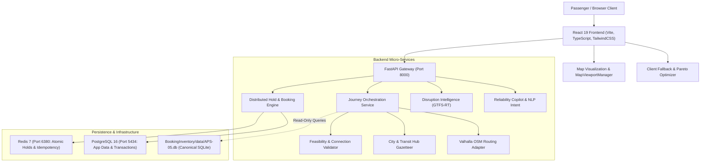

# KogniSync System Architecture Specification

## 1. Executive Architecture Summary

KogniSync is a distributed multimodal travel orchestration and concurrency-safe booking platform built for high-throughput, latency-sensitive transit planning. It combines deterministic optimization algorithms, asynchronous distributed holds, real-time disruption monitoring, and intelligent geographic visualization into an integrated passenger mobility platform.

---

## 2. Canonical Data Immutability Contract

The directory `BookingInventory/` represents the authoritative external reference standard provided by the organizer (Kognivera Problem Statement APS-05).

- **Immutability Contract:** All files inside `BookingInventory/` are strictly **read-only**.
- **Database Identity:** `BookingInventory/data/APS-05.db` is canonical.
- **Verification Standard:** SHA-256 checksum must match `F9B4B3185D91649C454BC70214AF83F69BB2D4D7AB7B9C7FB5AF9B900D52B10A`.
- Application write workloads persist to PostgreSQL (`kognisync_db`) and Redis; the canonical SQLite database is queried exclusively via read-only connections.

---

## 3. Subsystem Specifications

### 3.1 Distributed Booking & Inventory Engine
The booking engine enforces absolute concurrency safety and prevents overbooking across distributed transactions:
- **Temporary Hold Engine:** Sub-second TTL holds executed via atomic Redis Lua scripts (`hold_inventory.lua`).
- **Mathematical Invariant:** `booked_units + held_units <= total_inventory` enforced unconditionally at both Redis and database levels.
- **Idempotency Protection:** Requests bearing `Idempotency-Key` headers are cached in Redis with request-hash validation, guaranteeing at-most-once execution.
- **Saga Compensation Coordinator:** Multimodal line-item bookings execute with two-phase rollback; failure in any downstream segment automatically triggers compensating cancellations.

### 3.2 Multimodal Journey Orchestration Engine
Plans door-to-door itineraries connecting localized pickup, regional intercity corridors, and destination urban transit:
1. **Locality & GPS Resolution:** Resolves specific neighborhoods (e.g. Udayapura) to exact geographic coordinates while anchoring to appropriate multimodal hubs (railway junctions, airports, bus terminals).
2. **5 Canonical Archetypes:**
   - **Fastest:** Priority Cab $\to$ Commercial Flight $\to$ Priority Cab.
   - **Best Value:** Rapido Auto $\to$ High-Speed Rail (Vande Bharat) $\to$ Rapido Auto.
   - **Cheapest:** Public Feeder Bus $\to$ Superfast Rail $\to$ City Feeder Bus.
   - **Greenest:** Zero-Emission EV Shuttle / Metro $\to$ Electrified Rail $\to$ Urban Metro.
   - **Comfortable:** Executive Chauffeur $\to$ Premium 1st AC Rail $\to$ Executive Chauffeur.
3. **Pareto Optimization:** Implements multi-objective Pareto dominance sorting across four normalized criteria: Cost, Duration, Comfort Score, and Carbon Footprint ($CO_2$).

### 3.3 Timetable Feasibility & Downstream Uncertainty Propagation
Solves the real-world disconnect between theoretical route duration and scheduled service realities:
- **Published Schedule Grounding:** Known commercial rail operations (e.g., Karnataka Express 12627) are anchored to official published timetable departures (19:20 IST daily).
- **Operational Regulation Integration:** Date-specific operational notices (e.g. SWR PR No. 1404) are surfaced transparently without arbitrarily inflating guaranteed terminal delay.
- **Interval Propagation:** Propagates incoming train arrival windows (09:00–10:30 IST), terminal transfer buffers (15 min), and urban headway waiting times (0–5 min) through downstream connections, projecting accurate Rajiv Chowk arrival windows between 09:21 and 10:56 IST.
- **Past Departure Elimination:** Automatically identifies and eliminates expired past departure options unless historical test auditing is explicitly requested.

### 3.4 Responsive Map & Viewport Persistence (`MapViewportManager`)
- **Persistence Architecture:** Intercepts Leaflet viewport modifications, isolating programmatic transitions from user interactions.
- **User Zoom/Pan Protection:** When a user zooms or pans into an itinerary segment, `MapViewportManager` preserves the viewport across React component re-renders, background telemetry polling, marker clicks, and route geometry enrichment.
- **Intentional Framing:** Automatic bounds fitting triggers only on initial journey load, explicit user journey selection, or clicking "Fit Whole Route".
- **Coordinate Hygiene:** Strict validation guards prevent NaN, Infinity, or Null Island (0.0, 0.0) coordinates from polluting spatial bounds or Leaflet layers.

### 3.5 Disruption Intelligence & Live Feeds
- **Feed Ingestion:** Connects to authorized GTFS-RT protocol buffer feeds for vehicle positions, trip updates, and service alerts.
- **SSRF Hardening:** HTTP requests to external transit endpoints enforce IP-pinned transport with loopback and RFC 1918 private address filtering.
- **Identifier Matching:** Correlates real-time transit alerts with active journey segments using exact line, agency, and station matching.

---

## 4. Data Provenance & Transparency Standard

KogniSync maintains an explicit provenance hierarchy for all displayed data attributes:

| Provenance Level | Definition | Behavior & System Rule |
| :--- | :--- | :--- |
| `provider_live` | Grounded in verified live transit feed (GTFS-RT, live carrier API). | Displayed with live verification badge and timestamp. |
| `deterministic_estimate` | Derived from corridor physics, geographic distances, or published timetables. | Labeled as estimated schedule or modeled duration; vehicle numbers omitted unless service is scheduled. |
| `simulated` | Synthetic inventory or capacity for demo and simulation scenarios. | `isRealInventory: false`; remaining units ungrounded (`undefined`). |
| `unknown` | Attribute data could not be determined or telemetry is offline. | Transparently disclosed in journey notices; never masked with synthetic data. |

---

## 5. Deployment & Container Topology

| Service | Container Name | Image | Host Port | Internal Port | Health Check |
| :--- | :--- | :--- | :--- | :--- | :--- |
| **PostgreSQL** | `kognisync-postgres` | `pgvector/pgvector:pg16` | `5434` | `5432` | `pg_isready -U kognisync -d kognisync_db` |
| **Redis** | `kognisync-redis` | `redis:7-alpine` | `6380` | `6379` | `redis-cli ping` |
| **Valhalla** *(optional)* | `kognisync-valhalla` | `ghcr.io/gis-ops/docker-valhalla` | `8002` | `8002` | HTTP `GET /status` |
| **FastAPI Backend** | Host process | Python 3.13 / Uvicorn | `8000` | `8000` | HTTP `GET /health` |
| **React Frontend** | Host process | Vite / Nginx | `5173` | `5173` | HTTP `GET /` |
