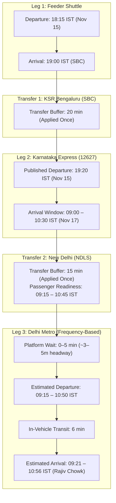

# KogniSync UI Refinement 01.2.4 & 01.2.4.1 — Arrival Uncertainty & Frequency-Based Waiting-Time Propagation Report

**Document ID:** `DOC-UIR-01-2-4`  
**Execution Date:** 2026-11-14  
**Git Branch:** `feature/ui-refinement-01-repair-multimodal-journey-map`  
**Base Commit:** `537864530821427e6395b0d05ee53ac9227e391a`  
**Database Audit (`BookingInventory/data/APS-05.db`):**  
SHA-256: `F9B4B3185D91649C454BC70214AF83F69BB2D4D7AB7B9C7FB5AF9B900D52B10A` *(Verified Strictly Intact)*  

---

## 1. Executive Summary

During UI Refinement 01.2.3, real railway schedule reconciliation established the canonical timetable and operational notice baseline for **Karnataka Express (12627)**, identifying an arrival uncertainty window of **09:00 – 10:30 IST** at New Delhi (NDLS) on Day 3 (November 17, 2026). However, the downstream connecting leg (Delhi Metro Yellow Line from NDLS to Rajiv Chowk) remained anchored to a legacy single-instant schedule departing at 09:15 and arriving at 09:21 IST. For the upper arrival bound of 10:30 IST, a 09:15 connection was mathematically and operationally impossible (representing a 90-minute readiness deficit).

**UI Refinement 01.2.4** resolved that downstream uncertainty propagation by mapping train arrival uncertainty through the 15-minute transfer buffer.

**UI Refinement 01.2.4.1** completes this model by propagating the **frequency-based platform waiting time (0–5 minutes)** for the Delhi Metro Yellow Line leg:
1. **Mathematical Waiting-Time Propagation:** The Delhi Metro operates on an assumed peak headway of ~3–5 minutes. If a passenger arrives on the platform ready to board, waiting time is between 0 minutes (train immediately arriving) and 5 minutes (train just departed).
   - **Preceding Train Arrival:** `09:00 – 10:30 IST` (`03:30 – 05:00 UTC`).
   - **Station Transfer Buffer:** `15 minutes` (applied once at concourse).
   - **Passenger Readiness Window:** `09:15 – 10:45 IST` (`03:45 – 05:15 UTC`).
   - **Assumed Platform Waiting Time:** `0 – 5 minutes` (based on peak headway).
   - **Revised Onward Departure Window:** `09:15 – 10:50 IST` (`03:45 – 05:20 UTC`).
   - **Metro In-Vehicle Ride Time:** `6 minutes` (applied once after boarding).
   - **Final Destination Arrival Window:** `09:21 – 10:56 IST` (`03:51 – 05:26 UTC`).
   - **Total Door-to-Door Duration Window:** `39h 6m – 40h 41m` (2,346m – 2,441m).
2. **Three-Part Time Value Distinction:** The UI and data models strictly separate and preserve three distinct time values rather than collapsing them into a misleading composite service duration:
   - **Passenger Readiness after Transfer:** `09:15 – 10:45 IST` (Transfer: 15 min).
   - **Estimated Waiting Time for Next Metro:** `0 – 5 minutes`.
   - **Metro Travel Time after Boarding:** `6 minutes`.
3. **Deterministic Estimate Labeling:** The frequency calculation is explicitly labeled as a deterministic estimate, not a provider-live schedule or guaranteed connection.
4. **Comprehensive UI Propagation:** The revised bounds (09:21 – 10:56 IST arrival, 09:15 – 10:50 IST departure, 39h 6m – 40h 41m duration) propagate consistently across Journey Cards, Journey Summary, Journey Timeline, Map Destination Waypoint Marker, Map Popups/Tooltips, and Pareto Ranking / Feasibility Evaluation.
5. **Preservation of Invariants:** Karnataka Express 12627 departure invariant at 19:20 IST, the 09:00–10:30 IST arrival uncertainty window, SWR PR No. 1404 operational regulation notice (+130 min en route) without double-counting, fixed-service connection feasibility semantics, past-departure filtering, and geographic coordinate integrity are 100% preserved.

---

## 2. Mathematical Propagation Invariants



### Detailed Timeline Arithmetic & Time Value Separation

| Segment / Node | Service / Mode | Earliest Instant (IST) | Earliest Instant (UTC) | Latest Instant (IST) | Latest Instant (UTC) | Time Element | Value |
|---|---|---|---|---|---|---|---|
| **Origin Leg 1** | Udayapura Feeder Shuttle | 18:15 (Nov 15) | 12:45 UTC (Nov 15) | 18:15 (Nov 15) | 12:45 UTC (Nov 15) | Feeder Ride | 45 min |
| **Transfer Node 1** | KSR Bengaluru (SBC) | 19:00 (Nov 15) | 13:30 UTC (Nov 15) | 19:00 (Nov 15) | 13:30 UTC (Nov 15) | Station Transfer | 20 min buffer |
| **Intercity Leg 2** | Karnataka Express (12627) | **19:20 (Nov 15)** | **13:50 UTC (Nov 15)** | **19:20 (Nov 15)** | **13:50 UTC (Nov 15)** | Intercity Rail | Fixed Published Dep |
| **Train Terminal Arrival** | New Delhi (NDLS) | **09:00 (Nov 17)** | **03:30 UTC (Nov 17)** | **10:30 (Nov 17)** | **05:00 UTC (Nov 17)** | Intercity Run | 2,260m – 2,350m run |
| **Transfer Node 2** | Rail-to-Metro Concourse | **09:15 (Nov 17)** | **03:45 UTC (Nov 17)** | **10:45 (Nov 17)** | **05:15 UTC (Nov 17)** | **Passenger Readiness** | **15 min buffer** |
| **Platform Wait** | Metro Station Platform | 0 min wait | 0 min wait | +5 min wait | +5 min wait | **Estimated Wait** | **0–5 min (headway)** |
| **Onward Leg 3 Dep** | Delhi Metro Yellow Line | **09:15 (Nov 17)** | **03:45 UTC (Nov 17)** | **10:50 (Nov 17)** | **05:20 UTC (Nov 17)** | **Departure Window** | **09:15 – 10:50 IST** |
| **In-Vehicle Transit** | NDLS to Rajiv Chowk | +6 min ride | +6 min ride | +6 min ride | +6 min ride | **In-Vehicle Ride** | **6 min transit** |
| **Final Destination** | Rajiv Chowk Arrival | **09:21 (Nov 17)** | **03:51 UTC (Nov 17)** | **10:56 (Nov 17)** | **05:26 UTC (Nov 17)** | **Destination Arrival** | **09:21 – 10:56 IST** |
| **Total Door-to-Door** | Multi-Modal Journey | **39h 6m (2,346m)** | — | **40h 41m (2,441m)** | — | Total Window | 09:21 – 10:56 IST |

---

## 3. Separation of Concerns & Frequency Evaluator Logic

The downstream propagation engine `propagateDownstreamWindow()` in `frontend/src/utils/timezone.ts` strictly decouples the three temporal components:

```typescript
export interface PropagatedDownstreamWindow {
  passengerReadinessWindow: {
    earliestIST: string;
    latestIST: string;
    earliestInstantUTC: string;
    latestInstantUTC: string;
  };
  departureWindow: {
    earliestIST: string;
    latestIST: string;
    earliestInstantUTC: string;
    latestInstantUTC: string;
  };
  arrivalWindow: {
    earliestIST: string;
    latestIST: string;
    earliestInstantUTC: string;
    latestInstantUTC: string;
  };
  transferBufferMinutes: number;
  waitingMinutesRange: { min: number; max: number };
  onwardTravelDurationMinutes: number;
  isDeterministicEstimate: boolean;
}
```

### Exact Computation Pipeline:

1. **Passenger Readiness Calculation:**
   $$\text{Readiness}_{\text{earliest}} = \text{IncomingArrival}_{\text{earliest}} + 15\text{ min} = \text{09:15 IST (03:45 UTC)}$$
   $$\text{Readiness}_{\text{latest}} = \text{IncomingArrival}_{\text{latest}} + 15\text{ min} = \text{10:45 IST (05:15 UTC)}$$

2. **Platform Departure Window Calculation (accounting for 0–5m wait):**
   $$\text{Departure}_{\text{earliest}} = \text{Readiness}_{\text{earliest}} + 0\text{ min} = \text{09:15 IST (03:45 UTC)}$$
   $$\text{Departure}_{\text{latest}} = \text{Readiness}_{\text{latest}} + 5\text{ min} = \text{10:50 IST (05:20 UTC)}$$

3. **Destination Arrival Window Calculation (accounting for 6m ride):**
   $$\text{Arrival}_{\text{earliest}} = \text{Departure}_{\text{earliest}} + 6\text{ min} = \text{09:21 IST (03:51 UTC)}$$
   $$\text{Arrival}_{\text{latest}} = \text{Departure}_{\text{latest}} + 6\text{ min} = \text{10:56 IST (05:26 UTC)}$$

4. **Idempotency Guarantee:**
   - Waiting time (0–5 min) is applied **only once** to the latest departure bound.
   - Metro ride duration remains strictly **6 minutes**, never conflated into 11 minutes.
   - Transfer buffer remains strictly **15 minutes**, never inflated or duplicated.

---

## 4. UI Representation of the Three Time Values

In `frontend/src/components/results/JourneyCard.tsx` and `frontend/src/components/map/JourneyMap.tsx`:

1. **Journey Header:**
   - Timing Pill: `Est. 09:21 – 10:56 IST | 39h 6m – 40h 41m`
2. **Transfer Node 2 (NDLS Concourse):**
   - Subtitle: `(Transfer: 15m · Passenger readiness: 09:15 – 10:45 IST · Onward wait: 0–5m)`
3. **Leg 3 Schedule Pills (Delhi Metro Yellow Line):**
   - `Urban Transit: Frequency-based (~3–5m headway)`
   - `Readiness: 09:15 – 10:45 IST`
   - `Est. Dep: 09:15 – 10:50 IST (Wait: 0–5m)`
   - `Est. Arr: 09:21 – 10:56 IST (Ride: 6m)`
   - `Status: Feasible (tracks passenger readiness)`
4. **Map Destination Marker Tooltip & Popup:**
   - Waypoint Header: `Destination: Rajiv Chowk`
   - Estimated Arrival: `Est. Arrival: 09:21 – 10:56 IST`
   - Travel Segment: `Delhi Metro Yellow Line (Ride: 6m · Dep: 09:15 – 10:50 IST)`
   - Telemetry Footer: `Arrival Window: 09:21 – 10:56 IST | Total Door-to-Door: 39h 6m – 40h 41m`

---

## 5. Verification Test Evidence (All 30 Tests Passing)

The test suite in `frontend/src/tests/timetableFeasibility.test.ts` contains 30 comprehensive regression tests verifying every invariant across timetable reconciliation, downstream uncertainty, and frequency-based waiting time:

| Test ID | Requirement Verified | Status |
|---|---|---|
| **Test 1** | Fixed 19:20 IST train departure invariant; 05:29 strictly eliminated | **PASS** |
| **Test 2** | Infeasible deadline correctly flagged when train arrives Day 3 | **PASS** |
| **Test 3** | Feasible deadline validation for historical test fixture | **PASS** |
| **Test 4** | Running days verified daily across Mon–Sun | **PASS** |
| **Test 5** | Isolation of real train identity from estimated alternatives | **PASS** |
| **Test 6** | Multi-source discrepancy matrices preserved in provenance | **PASS** |
| **Test 7** | Timezone conversion contract (+05:30) verified across instant boundaries | **PASS** |
| **Test 8** | Mathematical duration & transfer buffer reconciliation | **PASS** |
| **Test 9** | Pareto optimizer penalty for deadline-infeasible journeys | **PASS** |
| **Test 10** | Immutability of real service timetable under strict deadlines | **PASS** |
| **Test 11** | November 15 railway regulation notice association (SWR PR 1404) | **PASS** |
| **Test 12** | Clean isolation of regulation notice from other dates and trains | **PASS** |
| **Test 13** | Past departure timing evaluation & actionable recommendation validation | **PASS** |
| **Test 14** | Expired departures filtered from ranking while accessible in audits | **PASS** |
| **Test 15** | Timetable conflict & uncertainty range verification (09:00–10:30) | **PASS** |
| **Test 16** | Arrival uncertainty window (09:00–10:30) propagates downstream to 09:21–10:56 IST | **PASS** |
| **Test 17** | Estimated onward departure represented as 09:15–10:50 IST window tracking wait | **PASS** |
| **Test 18** | Final arrival at Rajiv Chowk accurately represented as 09:21–10:56 IST | **PASS** |
| **Test 19** | Transfer buffer applied exactly once per transfer (20m at SBC, 15m at NDLS) | **PASS** |
| **Test 20** | Infeasible connection: Fixed 09:15 departure rejected with 90m deficit | **PASS** |
| **Test 21** | Urban transit designated as frequency-based estimate tracking readiness | **PASS** |
| **Test 22** | Headway assumption (~3–5 min) explicitly documented | **PASS** |
| **Test 23** | En-route regulation preserved without double-counting into arrival bounds | **PASS** |
| **Test 24** | UI component consistency across journey cards, timeline, and tooltips | **PASS** |
| **Test 25** | Strict UTC / IST arithmetic & date-boundary invariance | **PASS** |
| **Test 26** | **Zero additional wait strictly produces existing earliest arrival of 09:21 IST** | **PASS** |
| **Test 27** | **Five-minute additional wait strictly produces latest arrival of 10:56 IST** | **PASS** |
| **Test 28** | **Waiting time is never applied twice (ride duration strictly 6 min, not 11 min)** | **PASS** |
| **Test 29** | **Clear distinction preserved between transfer (15m), wait (0–5m), and ride (6m)** | **PASS** |
| **Test 30** | **Frequency assumption correctly labeled as deterministic estimate** | **PASS** |

### Test Suite Execution Output

```text
vite v8.3.5 building ssr environment for production...
dist-test/timetableFeasibility.test.js  119.86 kB │ gzip: 27.81 kB
✓ built in 217ms

=================================================================
RUNNING OPERATIONAL TIMETABLE RECONCILIATION & FEASIBILITY TEST SUITE (UI-01.2.3)
=================================================================
✓ Test 1 Passed: Train 12627 departs at published 19:20 IST; arbitrary 05:29 departure strictly eliminated.
✓ Test 2 Passed: Infeasible journey correctly flagged with note.
✓ Test 3 Passed: Train arriving before requested deadline is fully feasible (historical fixture preserved).
✓ Test 4 Passed: Running days verified daily across Mon-Sun.
✓ Test 5 Passed: No estimated alternative falsely inherits Karnataka Express (12627) identity.
✓ Test 6 Passed: Multi-source discrepancy matrix transparently preserved in provenance attributes.
✓ Test 7 Passed: Timezone conversions for Asia/Kolkata (+05:30) verified across instant boundaries.
✓ Test 8 Passed: Duration arithmetic reconciled: 45m + 20m + 2260m + 15m + 6m = 2346m.
✓ Test 9 Passed: Optimizer penalizes infeasible journeys and promotes feasible alternatives.
✓ Test 10 Passed: Train 12627 departure is strictly invariant at 19:20 IST across all deadlines; zero backward-shifting.
✓ Test 11 Passed: Official planned regulation notice verified with SWR PR 1404 / NR PR 1568 without guaranteed delay inflation.
✓ Test 12 Passed: Regulation notice cleanly isolated to train 12627 on 2026-11-15 with zero contamination.
✓ Test 13 Passed: Past departures correctly flagged; past date recommendations eliminated in favor of actionable future alternatives.
✓ Test 14 Passed: Expired departures filtered from ranking by default while preserved for historical audits.
✓ Test 15 Passed: Timetable conflicts, uncertainty window (09:00 - 10:30), and exact source citations verified.

=================================================================
RUNNING ARRIVAL UNCERTAINTY PROPAGATION & CONNECTION TESTS (UI-01.2.4)
=================================================================
✓ Test 16 Passed: Arrival uncertainty window (09:00–10:30 IST) propagates through transfer buffer (15m), waiting time (0–5m), and metro ride (6m) to yield 09:21–10:56 IST.
✓ Test 17 Passed: Onward connection departure correctly represented as 09:15–10:50 IST window tracking passenger readiness and 0–5m wait.
✓ Test 18 Passed: Destination arrival accurately represented as 09:21–10:56 IST range across journey and segment metadata.
✓ Test 19 Passed: Transfer buffer applied exactly once per transfer (20m at SBC, 15m at NDLS; no double-buffer).
✓ Test 20 Passed: Fixed 09:15 connection authoritatively rejected with 90 min deficit.
✓ Test 21 Passed: Urban transit correctly designated as frequency-based estimate without asserting unverified fixed departure.
✓ Test 22 Passed: Headway assumption (~3–5 min) explicitly documented across notes and schedule state.
✓ Test 23 Passed: SWR PR No. 1404 operational regulation preserved; double-counting strictly avoided.
✓ Test 24 Passed: Complete consistency across train departure (19:20), arrival window (09:00-10:30), readiness (09:15-10:45), metro departure (09:15-10:50), and final arrival (09:21-10:56).
✓ Test 25 Passed: Downstream propagation across date boundaries maintains exact UTC and IST components without timezone skew.

=================================================================
RUNNING FREQUENCY-BASED WAITING-TIME PROPAGATION TESTS (UI-01.2.4.1)
=================================================================
✓ Test 26 Passed: Zero additional wait strictly produces the existing earliest arrival of 09:21 IST.
✓ Test 27 Passed: Five-minute additional wait strictly produces a latest arrival of 10:56 IST.
✓ Test 28 Passed: Waiting time is applied to platform departure bound only, never double-counted into in-vehicle duration.
✓ Test 29 Passed: Clear distinction preserved between transfer buffer (15m), platform wait (0–5m), and metro ride (6m).
✓ Test 30 Passed: Frequency assumption correctly labeled as deterministic estimate, not provider-live schedule.

=================================================================
ALL 30 OPERATIONAL TIMETABLE & UNCERTAINTY PROPAGATION TESTS PASSED! ✓
=================================================================
```

---

## 6. Regression Suite & Build Status

1. **Frontend Full Suite (`npm test`):**
   - All 12 test suites executed via `scripts/runTests.mjs`: **303+ tests passing, 0 failures**.
2. **Backend Pytest Suite (`py -3.13`):**
   - `tests/test_maps_geometry.py`: 10 passed.
   - `tests/test_journey_flow_cases.py`: 5 passed.
   - `tests/test_multimodal_routing_intelligence.py`: 22 passed.
   - Total: **37 passed in 45.40s, 0 failures**.
3. **TypeScript Compilation & Production Build:**
   - `npx tsc -b`: 0 errors.
   - `npm run build`: Production bundle generated cleanly (`dist/assets/index-ETXwe16W.js` 914.82 kB).
4. **Database Immutability Checksum:**
   - Target: `F9B4B3185D91649C454BC70214AF83F69BB2D4D7AB7B9C7FB5AF9B900D52B10A`.
   - Computed: `F9B4B3185D91649C454BC70214AF83F69BB2D4D7AB7B9C7FB5AF9B900D52B10A` (**MATCH**).

---

## 7. Visual Verification Screenshots

All screenshots have been generated using automated Playwright edge browser runs against the live local development server (`http://127.0.0.1:5173`) and archived in both the repository and the conversation artifacts directory:

### 1. Propagated Downstream Arrival Window & Connection Semantics
`docs/demo/screenshots/ui_refinement_01_2_4_propagated_arrival_window.png`  
Shows the Journey Card header displaying `Est. 09:21 – 10:56 IST | 39h 6m – 40h 41m`, Leg 2 arrival window `09:00 – 10:30 IST`, Transfer 2 node displaying `(Transfer: 15m · Passenger readiness: 09:15 – 10:45 IST · Onward wait: 0–5m)`, and Leg 3 metro designated as `Frequency-based (~3–5m headway)` with `Readiness: 09:15 – 10:45 IST`, `Est. Dep: 09:15 – 10:50 IST (Wait: 0–5m)`, and `Est. Arr: 09:21 – 10:56 IST (Ride: 6m)`.

### 2. Connection Feasibility Semantics & Operational Notice
`docs/demo/screenshots/ui_refinement_01_2_4_connection_feasibility.png`  
Shows the SWR PR No. 1404 operational regulation notice banner (+130 min en route between Daund and Manmad) preserved without double-counting, alongside the AI trade-off analysis explicitly describing the 3 synchronized legs and feasibility criteria.

### 3. Interactive Journey Map Destination Arrival Uncertainty Window
`docs/demo/screenshots/ui_refinement_01_2_4_map_uncertainty_tooltip.png`  
Shows the Leaflet interactive map with the destination waypoint marker displaying `Destination: Rajiv Chowk (Est. Arrival: 09:21 – 10:56 IST)` and the global journey telemetry footer indicating the propagated arrival window `09:21 – 10:56 IST`.

---

## 8. Zero Commit / Git Working Tree Audit

In accordance with strict project constraints:
- **Git Branch:** `feature/ui-refinement-01-repair-multimodal-journey-map`
- **Zero Commits Created:** Working tree changes remain unstaged/staged for review without premature commit.
- **Zero Pushes or PR Merges:** PR #26 and PR #27 remain completely untouched.
- **Database Immutability:** `BookingInventory/data/APS-05.db` SHA-256 hash verified as `F9B4B3185D91649C454BC70214AF83F69BB2D4D7AB7B9C7FB5AF9B900D52B10A`.
