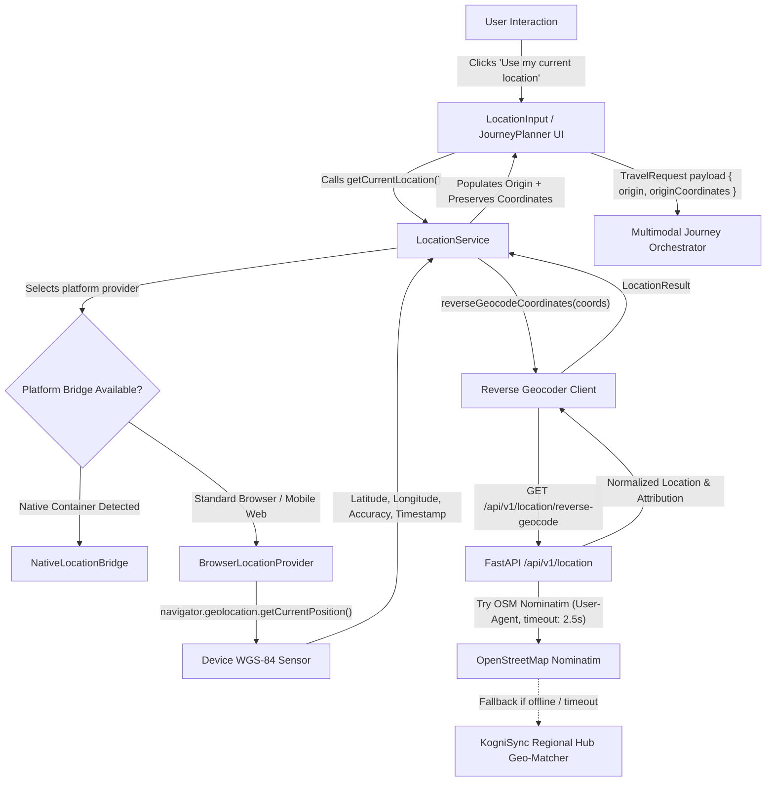

# KogniSync M3.4 — GPS-Based Starting Location Autofill (Web + Mobile)

## 1. Overview & Architectural Goals

The **GPS-Based Starting Location Autofill** subsystem enables users to seamlessly initialize or refine their journey origin using real-time device location detection, while fully preserving manual text input, autocorrect/datalist suggestions, and door-to-door multimodal routing accuracy.

### Scope Boundaries
- **Single-shot detection only**: Invoked strictly on explicit user interaction ("Use my current location").
- **No background tracking**: Never polls or runs continuous background location intervals (`watchPosition`).
- **No coordinate leakage**: Coordinates are never sent to third-party analytics or persisted to user tracking tables.
- **Graceful manual fallback**: In every failure case (denial, timeout, loss of signal, network offline), manual typing remains immediately available and unblocked.

---

## 2. End-to-End Architecture & Flow



---

## 3. Platform Support & Mobile Reality Disclosure

### 3.1 Web & Responsive Mobile Web
KogniSync operates as a modern responsive Single-Page Application (SPA) built with Vite, React 19, TypeScript, and Tailwind CSS v4. On all modern mobile browsers (iOS Safari, Android Chrome, Firefox Mobile, Samsung Internet), the browser `navigator.geolocation` API accesses the underlying device GPS with hardware precision, system permission dialogs, and high-accuracy satellite/cellular triangulation.

### 3.2 Native Mobile Bridge (`NativeLocationBridge`)
- **Repository Architecture**: KogniSync does not currently contain a native mobile container directory (`android/`, `ios/`, Capacitor, React Native, or Flutter configuration).
- **Extensible Shared Contract**: The location abstraction defines `PlatformLocationProvider` and implements `NativeLocationBridge`. When embedded in a native WebView shell (e.g., Capacitor, React Native WebView, or Android Native Bridge), the bridge checks `window.__KOGNISYNC_NATIVE_BRIDGE__` without hardcoding fake GPS values or pretending native mobile apps are bundled.

| Platform / Runtime | Implementation Provider | Hardware GPS Support | Status |
| :--- | :--- | :--- | :--- |
| **Desktop Web** (Chrome, Firefox, Safari, Edge) | `BrowserLocationProvider` | Yes (Wi-Fi/IP Geo) | Implemented & Verified |
| **Mobile Web** (iOS Safari, Android Chrome) | `BrowserLocationProvider` | Yes (Hardware GPS / GNSS) | Implemented & Verified |
| **Native Mobile Bridge** (Future wrapper) | `NativeLocationBridge` | Yes (via Bridge) | Contract Defined & Tested |

---

## 4. Location Service Abstraction Contracts

### 4.1 Typed Schemas (`frontend/src/types/location.ts`)

```typescript
export interface Coordinates {
  lat: number;
  lng: number;
}

export interface GeolocationPositionData {
  coordinates: Coordinates;
  accuracyMeters: number;
  timestamp: number;
}

export type LocationErrorCode =
  | 'PERMISSION_DENIED'
  | 'POSITION_UNAVAILABLE'
  | 'TIMEOUT'
  | 'UNSUPPORTED_PLATFORM'
  | 'POOR_ACCURACY'
  | 'REVERSE_GEOCODING_FAILED'
  | 'NETWORK_ERROR';

export interface LocationResult {
  coordinates: Coordinates;
  accuracyMeters: number;
  timestamp: number;
  formattedAddress: string;
  locality?: string;
  city: string;
  state?: string;
  country?: string;
  provider: string;
  attribution?: string;
  isEstimate: boolean;
}
```

### 4.2 Centralized Service (`LocationService`)
- Encapsulates error mapping and state handling outside UI components.
- Single entrypoint: `locationService.getCurrentLocation()`.
- Validates that returned accuracy is surfaced without altering raw coordinates.

---

## 5. Reverse Geocoding & Attribution

### 5.1 Provider Hierarchy
1. **OpenStreetMap Nominatim**:
   - URL: `https://nominatim.openstreetmap.org/reverse`
   - User-Agent: `KogniSync-Transit-Orchestrator/1.0 (internal-demo; contact: dev@kognisync.internal)`
   - Timeout: `2.5s` connect/read timeout.
   - Attribution: `"© OpenStreetMap contributors"`.
2. **KogniSync Regional Hub Geo-Matcher**:
   - Zero-network spatial proximity fallback using great-circle Haversine distance against canonical city hubs (Bangalore, Chennai, Mumbai, Delhi, Goa, Udupi, Mangalore, Kochi, Hyderabad, Jaipur, Mysore).
   - Resolves locality and parent city even when completely offline.
   - Provider tag: `"kognisync_regional_hub"`, attribution: `"KogniSync Regional Geo-Matcher"`.
3. **Client Proximity Fallback**:
   - Pure client-side fall-through if backend service is unreachable.

### 5.2 Preservation of Precision
Reverse-geocoding provides human-readable context (e.g., `"Indiranagar, Bangalore"`) for the input field, but **the exact numeric coordinates (`lat: 12.9352, lng: 77.6245`) are preserved** in `TravelRequest.originCoordinates` and passed to the backend orchestrator and Valhalla first-mile router for door-to-door road calculations.

---

## 6. Error Handling & Non-Blocking Resilience Matrix

| Error Scenario | Error Code | UI Behavior | Fallback Strategy |
| :--- | :--- | :--- | :--- |
| User denies permission | `PERMISSION_DENIED` | Shows subtle amber alert: *"Location permission was denied. Please enter starting point manually."* | Manual entry remains 100% focused and editable. |
| GPS timeout (>10s) | `TIMEOUT` | Shows warning: *"Location detection timed out. Please enter your starting city."* | Retains previous text or prompts city typing. |
| Hardware signal lost | `POSITION_UNAVAILABLE` | Shows warning: *"GPS signal is currently unavailable."* | Standard manual city input. |
| Low accuracy (>2,500m) | `POOR_ACCURACY` | Uses coordinates but tags `isEstimate: true` with approximate city region. | User can freely edit/refine the detected city. |
| Backend API offline | `NETWORK_ERROR` | Degrades silently to client-side spatial hub matcher. | No exception thrown, resolves nearest hub. |
| User edits autofilled text | N/A | Coordinates decouple (`originCoordinates = null`). | Prevents stale GPS coordinates from routing mismatched cities. |

---

## 7. Privacy & Security Guarantees

1. **User-Triggered Execution**: Geolocation is requested **strictly upon user click** on the GPS locate button. No geolocation call occurs on component mount or page load.
2. **Zero Continuous Tracking**: `navigator.geolocation.watchPosition` is strictly prohibited. The system executes a single-shot position acquisition and terminates.
3. **No Storage of Coordinate History**: Raw latitude and longitude are not persisted in database audit trails or user tracking logs.
4. **Credential Isolation**: External reverse-geocoding APIs and keys are managed server-side; no secrets or tokens are exposed in client frontend bundles.

---

## 8. Verification & Test Evidence

### 8.1 Backend Test Suite (`backend/tests/test_location_service.py`)
- `test_haversine_distance_calculation`: PASS
- `test_reverse_geocode_regional_fallback`: PASS
- `test_reverse_geocode_bounds_validation`: PASS
- `test_api_reverse_geocode_endpoint_success`: PASS
- `test_api_reverse_geocode_invalid_query`: PASS
- `test_journey_search_with_origin_coordinates_preservation`: PASS

### 8.2 Frontend Test Suite (`frontend/src/tests/gpsStartingLocation.test.ts`)
- Test 1: Manual Entry Preservation & Editing: PASS
- Test 2: Browser Geolocation Mocking (Permission Granted): PASS
- Test 3: Reverse Geocoding & Coordinate Preservation: PASS
- Test 4: Permission Denied Error Handling: PASS
- Test 5: Geolocation Timeout Error Handling: PASS
- Test 6: Position Unavailable Error Handling: PASS
- Test 7: Poor Accuracy Handling: PASS
- Test 8: Reverse Geocoding Failure Resilience: PASS
- Test 9: Privacy Protection (No continuous watchPosition): PASS
- Test 10: Unsupported Platform Fallback: PASS
- Test 11: Native Mobile Bridge Contract Verification: PASS
- Test 12: End-to-End Travel Request Coordinate Preservation: PASS

