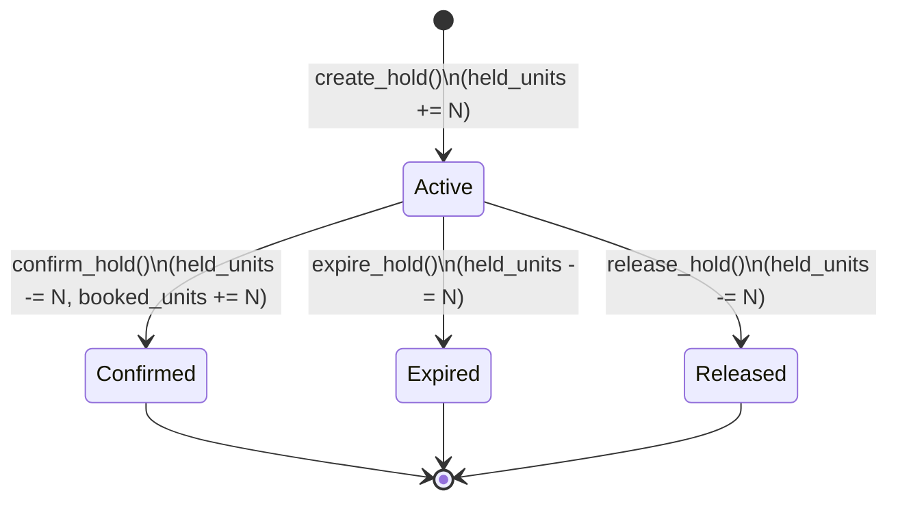

# KogniSync Booking Hold Lifecycle & Expiration Architecture

## 1. Executive Summary

This document defines the authoritative booking inventory hold lifecycle, expiration semantics, PostgreSQL transaction and concurrency locking model, and advisory Redis integration for KogniSync.

```text
┌────────────────────────────────────────────────────────────────────────┐
│                        KogniSync Booking Domain                        │
├────────────────────────────────────────────────────────────────────────┤
│                                                                        │
│   POSTGRESQL AUTHORITATIVE STORE                                       │
│   - Holds table: Authoritative hold status, expiry, and ownership      │
│   - Inventory table: Authoritative units allocation & invariant gate   │
│   - Concurrency: FOR UPDATE row-level locks + atomic conditional DML   │
│   - Release: Exactly-once inventory increment/decrement guarantee      │
│                                                                        │
│   REDIS ADVISORY ACCELERATOR (SUPPORTING ONLY)                         │
│   - Hold TTL countdown keys: kognisync:hold:{hold_id}                  │
│   - Prompt expiration notifications (keyspace events / webhooks)       │
│   - Zero Inventory Authority: Redis NEVER modifies inventory directly  │
│   - Resilient: Redis outages never block hold creation or confirmation │
└────────────────────────────────────────────────────────────────────────┘
```

---

## 2. Hold Lifecycle & State Transitions

Holds strictly adhere to the organizer's canonical `hold_status` enum: `active`, `confirmed`, `released`, `expired`.



### State Definitions
1. **`active`**:
   - Inventory units are temporarily locked (`inventory_calendar.held_units += N`).
   - Availability is decremented: `available = total_units - booked_units - held_units`.
   - Expires at `now + ttl_seconds` (default: 600s / 10 minutes).
2. **`confirmed`**:
   - Hold successfully converted into a confirmed booking.
   - Held units shifted atomically to booked units: `held_units -= N`, `booked_units += N`.
   - Invariant `booked_units + held_units <= total_units` is strictly maintained.
   - **Terminal state**: Cannot be expired, cancelled by hold workers, or double-confirmed.
3. **`expired`**:
   - Expiration timestamp reached without confirmation.
   - Units returned to availability: `held_units = max(0, held_units - N)`.
   - `released_at` timestamp recorded.
   - **Terminal state**: Exactly-once release guarantee.
4. **`released`**:
   - Explicitly cancelled by user before expiration.
   - Units returned to availability: `held_units = max(0, held_units - N)`.

---

## 3. Database Transaction & Concurrency Strategy

To guarantee zero double-releases, zero overbooking, and safe multi-worker execution, KogniSync employs **defense in depth**:

### A. Row-Level Locking (`SELECT ... FOR UPDATE`)
All hold operations begin by acquiring a row-level lock on the target entity:
```sql
SELECT * FROM holds WHERE hold_id = :hold_id FOR UPDATE;
```
On concurrent workers:
- Worker 2 blocks until Worker 1 commits.
- Upon acquiring the lock, Worker 2 evaluates the fresh, committed `hold.status`. If `status != 'active'`, Worker 2 exits immediately as a no-op (`return False`).

### B. Concurrent Batch Sweeps (`FOR UPDATE SKIP LOCKED`)
For periodic background sweeps across multiple instances:
```sql
SELECT * FROM holds 
WHERE status = 'active' AND expires_at <= :now 
ORDER BY expires_at ASC 
LIMIT :batch_size 
FOR UPDATE SKIP LOCKED;
```
`SKIP LOCKED` prevents lock contention between parallel worker pods. Worker instances process disjoint subsets of expired holds without blocking each other.

### C. Atomic Conditional DML (`UPDATE ... WHERE status = 'active'`)
To protect against race conditions even on database engines lacking row locks (e.g. SQLite test runners), state transitions use atomic conditional DML:
```sql
UPDATE holds 
SET status = 'expired', released_at = :now, updated_at = :now
WHERE hold_id = :hold_id AND status = 'active';
```
Only the transaction that receives `rowcount == 1` is authorized to call `inventory_repo.release_held_units()`. A racing transaction receives `rowcount == 0` and terminates without altering inventory.

---

## 4. Redis Responsibilities & Boundaries

Redis serves strictly as a **non-authoritative accelerator**:

| Capability | Role in Redis | Authoritative Authority |
| :--- | :--- | :--- |
| **Hold TTL countdown** | Key: `kognisync:hold:{hold_id}` with `EX = ttl_seconds` | PostgreSQL `holds.expires_at` |
| **Inventory count** | NOT CACHED in Redis (prevents stale inventory illusions) | PostgreSQL `inventory_calendar` |
| **Expiration action** | Redis TTL expiry triggers an immediate DB check | PostgreSQL `hold_service.expire_hold()` |
| **Failure Mode** | Redis down -> Operations log warning and continue | PostgreSQL transaction executes cleanly |

### Redis Failure Invariance
1. If Redis is unreachable during `create_hold()`: the hold is created authoritatively in PostgreSQL; Redis registration fails silently.
2. If Redis crashes: the periodic PostgreSQL worker sweep detects and expires holds reliably.
3. If a Redis expiry notification arrives late: the database checks `hold.status` under lock before taking action. If already confirmed or expired, it discards the event.

---

## 5. Expiration Worker & Operational Commands

### Worker Architecture (`HoldExpirationWorker`)
- Located at: [`backend/app/services/hold_expiration_worker.py`](file:///e:/KogniSync/KogniSync/backend/app/services/hold_expiration_worker.py)
- Periodically executes bounded batch sweeps (default: batch size 100, interval 10s).
- Isolates individual hold failures: if one record fails due to a network glitch or DB lock timeout, the worker logs the error and continues processing the remainder of the batch.
- Crash-resilient: When restarted after downtime, the first sweep recovers all holds that expired while the worker was offline.

### Operational CLI Commands
The worker can be executed via [`scripts/run_hold_worker.py`](file:///e:/KogniSync/KogniSync/scripts/run_hold_worker.py):

```bash
# Execute a single batch sweep and exit (ideal for cron jobs)
python scripts/run_hold_worker.py --once

# Run continuous background worker with custom sweep interval and batch size
python scripts/run_hold_worker.py --interval 10 --batch-size 100
```

---

## 6. Monitoring & Structured Log Events

The hold service and worker emit structured log events under `kognisync.holds` and `kognisync.hold_worker`:

- `Hold 'hld_xxx' successfully expired. Released N units for inventory 'inv_yyy'`: Emitted on authoritative release.
- `Hold 'hld_xxx' already has status 'confirmed'. Skipping expiration`: Emitted when an expiration race is safely intercepted.
- `Hold sweep completed: processed=X, expired=Y, skipped=Z, failed=0`: Emitted per batch sweep.
