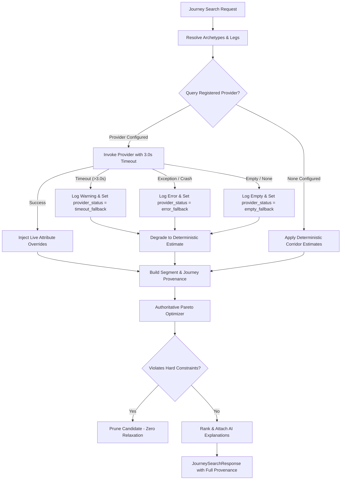

# KogniSync Multimodal Journey Data Provenance & Credibility (M2.1)

## 1. Overview & Core Mission

KogniSync provides intelligent multimodal travel orchestration by synthesizing multi-leg door-to-door journeys across air, rail, bus, cab, and urban transit. In early milestones, generated travel plans relied on corridor estimation models and synthetic availability to demonstrate routing and optimization mechanics.

**Milestone M2.1 introduces explicit data provenance and credibility boundaries.**
The objective is to ensure that users, frontend clients, and downstream operational services never mistake generated corridor estimates or simulated seat counts for confirmed real-world transport availability or inventory locks.

---

## 2. Provenance Taxonomy & Categories

Every journey, segment, and individual travel attribute carries explicit provenance metadata conforming to four canonical source types:

| Source Type | Description | Trust Boundary |
| :--- | :--- | :--- |
| `provider_live` | Directly retrieved from an authenticated real-time partner API (e.g., live flight ADS-B tracking, real-time train GPS, live operator inventory). | Authoritative for the specified snapshot timestamp. |
| `deterministic_estimate` | Computed via deterministic corridor modeling algorithms, published transit timetables, static distance/duration curves, or regulated fare matrices. | Reproducible and mathematically sound, but subject to real-world operational variance and delays. |
| `simulated` | Generated parametrically by demonstration fleet generators or mock simulators. Used exclusively for development and offline testing. | **Never real inventory.** Cannot be locked or ticketed. |
| `unknown` | Attributes where source information is missing, unverified, or third-party feeds returned unparsable payloads. | Treated strictly as unverified estimates; never trusted for booking. |

---

## 3. Granular Attribute-Level vs. Leg-Level Provenance

### The Conflation Anti-Pattern
A naive system might label an entire transport leg as `provider_live` simply because Google Routes or an airline API returned the route geometry or scheduled flight duration. Doing so creates a dangerous illusion of complete live confirmation when fares remain estimated and seat availability remains unverified.

### KogniSync Attribute-Level Architecture
KogniSync decouples leg-level and journey-level summaries from granular attribute provenance. Each `JourneySegment` contains an `attributes` dictionary detailing:

1. **`fare`**: Modeled by corridor base fare + distance multipliers (`deterministic_estimate`) vs. live carrier quotation (`provider_live`).
2. **`duration`**: Computed via corridor speed curves (`deterministic_estimate`) vs. live partner telematics (`provider_live`).
3. **`departure_time`**: Backward-anchored schedule estimate (`deterministic_estimate`) vs. live departure board (`provider_live`).
4. **`arrival_time`**: Calculated arrival estimate (`deterministic_estimate`) vs. live arrival board (`provider_live`).
5. **`carbon`**: Computed via mode emission factors (kg CO₂ / passenger-km) (`deterministic_estimate`).
6. **`availability`**: Simulated demonstration fleet capacity (`simulated`, `is_real_inventory = false`).

### Aggregation Rules
- **Leg-Level (`SegmentProvenanceSchema`)**:
  - `source_type = "provider_live"` ONLY if **every** critical attribute is verified by a live provider.
  - If a leg has a live provider for travel duration but deterministic fare estimation, `has_live_provider = True`, but `source_type = "deterministic_estimate"` and `is_estimate = True`.
- **Journey-Level (`JourneyProvenanceSchema`)**:
  - `overall_source_type = "mixed"` if any attribute is live while others remain estimated.
  - `overall_source_type = "deterministic_estimate"` if all legs are modeled without live partner feeds.
  - `is_fully_confirmed = False` is hardcoded across all synthesized journeys until an authoritative partner booking lock is established.

---

## 4. Failure Isolation & Degradation Semantics

External transport provider integrations are designed to fail safely without impacting the passenger's search experience:



### Safety Boundaries:
1. **Strict 3.0s Timeout**: Provider invocations are bounded by `asyncio.wait_for(timeout=3.0)`. If a carrier feed hangs, the search continues seamlessly using deterministic estimates.
2. **Zero Exception Leakage**: Internal database connection strings, credentials, or third-party stack traces are never exposed in API responses or logs. Status is recorded as `error_fallback_deterministic`.
3. **No Phantom Live Status**: An empty or partial response never claims live provenance.

---

## 5. Interaction with the Pareto Optimizer

The backend `JourneyOptimizerService` operates with complete mathematical integrity:
- **Zero Constraint Relaxation**: Hard budget caps (`budget_max`) and arrival deadlines (`preferred_arrival_before`) are strictly enforced regardless of data provenance. If no journey meets the budget, zero candidates are returned.
- **Data Credibility Notice in Explanations**: The optimizer attaches an explicit `data_credibility_notice` explaining that rankings are evaluated against deterministic corridor estimates.
- **Traceable Trade-offs**: Every journey candidate's trade-off list includes:
  `"Corridor-modeled estimates: fare and transit duration are unverified until live booking lock"`.

---

## 6. Concrete Journey Examples

### Example A: Fully Estimated Corridor Journey
```json
{
  "id": "jny-chennai-to-udupi-cheapest",
  "provenance": {
    "overallSourceType": "deterministic_estimate",
    "isFullyConfirmed": false,
    "hasLiveAttributes": false,
    "hasSimulatedAttributes": true,
    "summary": "Composed of deterministic estimates and simulated availability; real-world booking requires provider verification."
  },
  "segments": [
    {
      "segmentId": "seg-chennai-to-udupi-cheapest-02",
      "mode": "train",
      "provider": "Indian Railways Superfast",
      "availability": {
        "status": "available",
        "remainingUnits": 18,
        "isRealInventory": false
      },
      "provenance": {
        "sourceType": "deterministic_estimate",
        "providerName": "Indian Railways Superfast",
        "isEstimate": true,
        "hasLiveProvider": false,
        "attributes": {
          "fare": { "sourceType": "deterministic_estimate", "isEstimate": true },
          "duration": { "sourceType": "deterministic_estimate", "isEstimate": true },
          "availability": { "sourceType": "simulated", "isEstimate": true }
        }
      }
    }
  ]
}
```

### Example B: Mixed-Provenance Journey (Live Telematics + Estimated Fare)
```json
{
  "id": "jny-chennai-to-udupi-fastest",
  "provenance": {
    "overallSourceType": "mixed",
    "isFullyConfirmed": false,
    "hasLiveAttributes": true,
    "hasSimulatedAttributes": true,
    "summary": "Contains both provider-backed attributes and deterministic estimates. Availability is unverified."
  },
  "segments": [
    {
      "segmentId": "seg-chennai-to-udupi-fastest-02",
      "mode": "flight",
      "provider": "IndiGo Air Express",
      "provenance": {
        "sourceType": "deterministic_estimate",
        "providerName": "IndiGo Air Express",
        "isEstimate": true,
        "hasLiveProvider": true,
        "attributes": {
          "duration": {
            "sourceType": "provider_live",
            "providerName": "IndiGo Live ADS-B Tracking",
            "isEstimate": false,
            "notes": "Real-time corridor flight duration verified by provider."
          },
          "fare": {
            "sourceType": "deterministic_estimate",
            "isEstimate": true,
            "notes": "Corridor distance-modeled estimate; live fare lock required."
          },
          "availability": {
            "sourceType": "simulated",
            "isEstimate": true,
            "notes": "Simulated capacity for demonstration; unverified live inventory."
          }
        }
      }
    }
  ]
}
```

---

## 7. Prerequisites for Real-World Booking

Before any journey or segment generated by `JourneyOrchestrationService` can transition to a real-world confirmed reservation:

1. **Live Inventory Lock**: Downstream services must call the provider's authoritative hold or reservation API to lock specific seat/vehicle inventory.
2. **Canonical APS-05 Conformance**: For organizer inventory tables (`BookingInventory/`), concurrency-safe SQLite hold transactions with TTL expiration must be utilized without altering canonical schema.
3. **Price Quote Finalization**: The estimated fare must be replaced by an authenticated carrier price quote with fare validity timestamp.
4. **Identity Verification**: In accordance with KogniSync M1.5/M1.6, caller identity must be cryptographically authenticated via JWT before hold confirmation or cancellation.
5. **Clear User Disclosure**: The user interface must prominently display that search-stage results are corridor estimates and confirm final pricing prior to payment processing.
