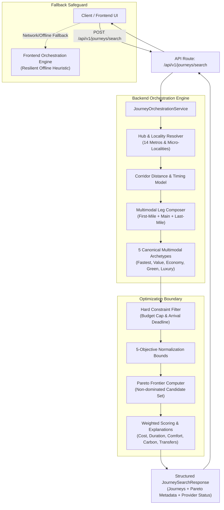

# KogniSync Multimodal Journey Orchestration Architecture

This document describes the architectural foundation established in Milestone M2.0 for backend-authoritative multimodal journey search, composition, constraint validation, and Pareto multi-objective optimization.

---

## 1. Executive Summary & Architecture Overview

Previously, multimodal journey generation and scoring occurred on the frontend client (`frontend/src/api/orchestrationEngine.ts`). In M2.0, the backend (`backend/app/services/journey/`) is established as the authoritative service for journey orchestration, exposing the canonical endpoint:

```http
POST /api/v1/journeys/search
```

The service coordinates travel intent inputs, metropolitan hub and locality resolution, dynamic corridor transit speed and pricing models, first-to-last mile segment connectivity, and strict Pareto multi-objective optimization with zero silent constraint relaxation.



---

## 2. Request & Response Lifecycle

### Request Flow
1. **Pydantic Validation**:
   - `origin` & `destination` are validated for non-empty string content.
   - `departure_date` strictly enforces `YYYY-MM-DD` formatting.
   - `budget_max` enforces non-negative constraints.
   - `passengers_count` enforces $\ge 1$.
   - Transparently accepts camelCase (`departureDate`, `preferredArrivalBefore`, `budgetMax`) and snake_case keys.

2. **Hub & Locality Context Resolution**:
   - Matches origin/destination against the 14-city metropolitan registry (`CITY_HUB_REGISTRY`) and neighborhood locality mappings (`LOCALITY_TO_CITY_MAP`).
   - If an origin is a micro-locality (e.g. `Udayapalya`), it resolves to a localized address node within `Bangalore`, creating a door-to-door first-mile leg.
   - Intercity hubs (railway stations, commercial airports, bus terminals, and rapid metro transit) are selected based on the transport archetype.

3. **Dynamic Corridor Distance & Fare Modeling**:
   - Corridor distance is determined via explicit lookup tables (e.g., Chennai–Udupi: 720 km, Delhi–Mumbai: 1,385 km) or Haversine distance with a $1.25\times$ road/rail winding factor.
   - Air, superfast rail, electric rail, and road transit speeds, ticket prices, and carbon footprints are computed proportionally from the verified corridor baseline.

4. **Sequential Leg Composition & Backward Timing**:
   - The user's target arrival (e.g. `20:00`) acts as the anchor point.
   - Leg 3 (last-mile pickup), Leg 2 (intercity transit), and Leg 1 (first-mile connection) are calculated backwards in time.
   - Realistic positive synchronization buffers are enforced:
     - Airport: 50 min check-in buffer; 25 min baggage & pickup buffer.
     - Rail / Bus: 15–20 min platform transfer buffers.
   - Mathematical invariants hold across all generated candidates:
     $$\text{totalPrice} = \sum \text{segment.price}$$
     $$\text{travelDurationMinutes} = \sum \text{segment.durationMinutes}$$
     $$\text{totalCarbonKg} = \sum \text{segment.carbonKg}$$

---

## 3. Multimodal Transport Archetypes

| Archetype | Category | First-Mile | Main-Transit Leg | Last-Mile | Core Strengths |
| :--- | :--- | :--- | :--- | :--- | :--- |
| **SyncAir Multi-Modal Link** | `fastest` | Priority SyncCab | Commercial Air Express (`IndiGo A321neo`) | Priority SyncCab | Minimizes door-to-door duration; priority gate transfers. |
| **Vande Bharat + Rapido** | `best_value` | Rapido QuickSync | High-Speed Electric Rail (160 km/h) | Rapido QuickSync | Optimal speed-to-cost Pareto frontier; bypasses city traffic. |
| **Economy Multi-Transit Link** | `cheapest` | City Feeder Bus | Superfast Intercity Rail (`Indian Railways`) | City Feeder Bus | Maximizes savings; lowest complete door-to-door fare. |
| **Net-Zero Electrified Corridor**| `greenest` | Electric Metro | 100% Electrified Solar Rail | Electric Metro / EV Shuttle | Lowest carbon emissions; up to 70% lower emissions than air. |
| **Executive Comfort SyncPass** | `comfortable` | Executive Chauffeur | 1st AC Shatabdi Executive Carriage | Executive Chauffeur | Maximum legroom, hot catering, and VIP lounge access. |

---

## 4. Optimizer Integration & Pareto Frontier Boundary

Rather than duplicating optimization math, `JourneyOrchestrationService` integrates directly with the backend's `JourneyOptimizerService`:

1. **Hard Constraints (Zero Relaxation)**:
   - `budget_max`: Prunes all candidate journeys whose total price exceeds the cap.
   - `preferred_arrival_before`: Prunes any option arriving after the requested deadline.
   - If no journey satisfies the constraints (e.g., impossible budget of ₹20), the service returns an empty list (`eligible_candidates = 0`) rather than silently relaxing user requirements.
2. **5-Objective Normalization**:
   - Normalizes raw metrics into $[0, 1]$ utility bounds across:
     - **Cost** (Minimization)
     - **Duration** (Minimization)
     - **Comfort** (Maximization, 1–10 scale)
     - **Carbon** (Minimization)
     - **Transfers** (Minimization)
3. **Pareto Dominance Classification**:
   - Identifies non-dominated choices where no other option is simultaneously cheaper, faster, more comfortable, and lower-carbon.
   - Sets `is_pareto_optimal = True` on frontier journeys.
4. **Deterministic Traceable Explanations**:
   - Generates deterministic bullet-point trade-offs and rankings comparing winners against alternatives without hallucinatory AI prompts.

---

## 5. Provider & Fallback Transparency

Every response from `/api/v1/journeys/search` includes explicit source and provider transparency:

```json
{
  "source": "backend_orchestrator",
  "providerStatus": {
    "transport": "catalog_modelled",
    "optimizer": "authoritative_pareto",
    "maps": "coordinate_geometry"
  }
}
```

* **No Fictitious Live Inventory**: Results are explicitly identified as catalog-modelled and coordinate-derived rather than pretending to be live airline GDS feeds.
* **Client Fallback Resilience**: The frontend (`frontend/src/api/journey.ts`) first attempts `POST /api/v1/journeys/search`. If the backend is unreachable or offline, it gracefully falls back to local client orchestration with a logged warning, preserving offline demo workflows without breaking the user experience.

---

## 6. Frontend Migration Roadmap

1. **Milestone M2.0 (Complete)**:
   - Backend journey orchestration service implemented and tested.
   - Endpoint `POST /api/v1/journeys/search` registered.
   - Typed frontend API client (`searchJourneysBackend`) added.
   - Resilient unwrap in `frontend/src/api/journey.ts` supporting both backend responses and local fallback.
2. **Next Steps (M2.1+)**:
   - Connect live booking hold endpoints (`POST /api/v1/holds`) directly from backend journey search results.
   - Transition full frontend search and filter states to consume backend responses exclusively when running in connected mode.
   - Retire legacy mock generation once full backend parity across all routes is verified.
