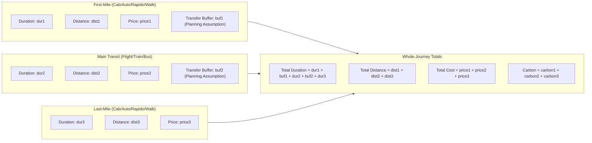

# Multimodal Routing Intelligence & Journey Quality (M3.3)

## 1. Executive Summary

Milestone **M3.3** enhances KogniSync's multimodal journey orchestration by integrating live road routing from the self-hosted **Valhalla OpenStreetMap Engine** into complete door-to-door journey connections:

$$\text{User Origin} \xrightarrow[\text{Live Road Route}]{\text{First Mile}} \text{Departure Hub} \xrightarrow[\text{Corridor Baseline}]{\text{Main Transport}} \text{Arrival Hub} \xrightarrow[\text{Live Road Route}]{\text{Last Mile}} \text{Final Destination}$$

This architecture provides high-fidelity road access transit times, validates physical and temporal connection feasibility between intermodal transfer nodes, avoids double-counting of buffers and travel metrics, integrates complete door-to-door costs into Pareto multi-objective optimization, and maintains granular attribute-level data provenance.

---

## 2. Phase 1 — Architecture and Capability Audit

### 2.1 Where First-Mile Segments Are Generated
- **Authoritative Backend**: In `backend/app/services/journey/service.py` within `JourneyOrchestrationService.search_journeys()`. Five canonical multimodal archetypes (`fastest`, `best_value`, `cheapest`, `greenest`, `comfortable`) define first-mile specifications (mode, local operator, default baseline duration, price, and transfer buffer).
- **Client Fallback Simulation**: In `frontend/src/api/orchestrationEngine.ts` and `frontend/src/api/mockData.ts` within `composeMultiModalJourneys()`, providing client-side simulation when the backend is offline.

### 2.2 Where Last-Mile Segments Are Generated
- **Authoritative Backend**: In `backend/app/services/journey/service.py`, connecting the archetype's main arrival hub (`arr_hub`) to the final destination user node (`dest_hubs.user_node`).
- **Client Fallback Simulation**: In `frontend/src/api/orchestrationEngine.ts`, completing the transfer from arrival terminals to the destination drop-off point.

### 2.3 Geographic Coordinate Verification
- All endpoints are backed by authoritative geographic coordinates in `backend/app/services/journey/hubs.py`:
  - `origin_hubs.user_node.coordinates`: Real locality coordinates (e.g., Chennai City Hub `13.0827, 80.2707`; Indiranagar Bangalore `12.9784, 77.6408`).
  - `dep_hub.coordinates`: Real airport, railway station, bus terminal, or metro station coordinates (e.g., Chennai Central `13.0827, 80.2755`; Kempegowda Airport `13.1986, 77.7066`).
  - `arr_hub.coordinates`: Real destination terminal coordinates (e.g., Mangaluru Central `12.8631, 74.8427`; Udupi Railway Station `13.3409, 74.7421`).
  - `dest_hubs.user_node.coordinates`: Real destination locality coordinates (e.g., Udupi City Hub `13.3409, 74.7421`; Manipal `13.3525, 74.7865`).
- Coordinate validity is verified against latitude $[-90.0, 90.0]$, longitude $[-180.0, 180.0]$, and non-null values.

### 2.4 Valhalla Regional Routing Feasibility
- Self-hosted Valhalla container (`kognisync-valhalla:latest@sha256:060da5...`) is active on `http://localhost:8002` with 1,427 pre-built routing tiles for the Geofabrik Southern India OSM extract (`southern-zone-latest.osm.pbf`).
- Supported modes for road network routing:
  - `walk` $\rightarrow$ Valhalla `pedestrian` costing (sidewalks, footpaths, crosswalks).
  - `rapido` $\rightarrow$ Valhalla `motorcycle` costing (two-wheeler road corridors).
  - `cab` / `auto` $\rightarrow$ Valhalla `auto` costing (urban street network).
  - `bus` $\rightarrow$ Valhalla `auto` costing (vehicular road distance along corridors; clearly documented as vehicular road routing rather than public-transit scheduled lines).
- Directly test-verified in M3.2:
  - Chennai $\rightarrow$ Bengaluru (325.1 km, 237.4 min, HTTP 200).
  - Mangaluru Central $\rightarrow$ KSRTC Bus Stand (4.04 km, 47.6 min walk, HTTP 200).
  - Bengaluru Railway $\rightarrow$ Majestic Concourse (2.02 km, 3.5 min motorcycle, HTTP 200).

### 2.5 Distribution of Logic: Frontend vs Backend
| Capability | Backend Authority | Frontend Role |
|------------|-------------------|---------------|
| Hub & Locality Resolution | Primary: `hubs.py` | Mirror: `orchestrationEngine.ts` (offline fallback only) |
| Provider Adapter Queries | Authoritative: `valhalla_adapter.py`, `google_routes_adapter.py` | None (calls `/api/v1/journeys/search`) |
| Transfer Feasibility Checks | Authoritative: `connection_validator.py` | None |
| Metric Aggregation | Authoritative: `JourneySchema` | Display: `formatDuration`, `formatCurrency` |
| Multi-Objective Optimization | Authoritative: `JourneyOptimizerService` | Display & Mirror: `optimizer.ts` (offline fallback only) |
| Route Polyline & Map Display | Schema: `EnrichedJourneyRoute` | Visual rendering: `JourneyMap.tsx` |

### 2.6 Metric Double-Counting Audit
- **Duration**:
  - `travel_duration_minutes` = $\sum_{s \in \text{segments}} s.\text{duration\_minutes}$ (pure transit time in vehicle or walking).
  - `waiting_duration_minutes` = $\sum s.\text{transfer\_buffer\_minutes}$ (explicit connection windows between legs).
  - `total_duration_minutes` = $\text{round}((\text{seg}_{\text{last}}.\text{arrival} - \text{seg}_{\text{first}}.\text{departure}).\text{total\_seconds}() / 60) = \text{travel\_duration} + \text{waiting\_duration}$.
  - **Audit conclusion**: Transfer buffers are neither added twice nor subtracted from travel time; in-vehicle transit time and buffer time are completely orthogonal.
- **Distance**:
  - `total_distance_km` = $\sum_{s \in \text{segments}} s.\text{distance\_km}$. Main transport distance does not overlap with access leg distances.
- **Cost**:
  - `total_price` = $\sum_{s \in \text{segments}} s.\text{price}$. First-mile fares, main transit tickets, and last-mile fares are strictly additive.

### 2.7 Contribution of Segment Metrics to Total Journey Metrics

---

## 3. Journey Connection Quality & Feasibility

### 3.1 Intermodal Transfer Planning Assumptions
Because official carrier check-in windows vary by airline, station, and operational conditions, KogniSync models transfer buffers as **explicit planning assumptions**:
- **Flight Departure Hub**: Minimum 45 min planning buffer (airport check-in, security screening, and gate arrival).
- **Train Departure Hub**: Minimum 15 min planning buffer (station concourse navigation, platform access, boarding).
- **Intercity Bus Terminal**: Minimum 15 min planning buffer (terminal bay check-in and boarding).
- **Metro Interchange**: Minimum 8 min planning buffer (fare gate tap-out/in and platform transfer).
- **Last-Mile Pick-Up**: Minimum 10 min planning buffer (deboarding, baggage retrieval, exit to cab/auto stand).

### 3.2 Hard Connection Feasibility Rules
Connections are validated prior to Pareto ranking. An impossible connection is **pruned from the eligible candidate set**:
1. **Chronological Validity**: Each segment must have $\text{departure} < \text{arrival}$.
2. **Sequential Connectivity**: For adjacent segments $s_i$ and $s_{i+1}$, $\text{arrival}(s_i) \le \text{departure}(s_{i+1})$. Negative connection windows are impossible and strictly rejected.
3. **Buffer Adequacy**: The elapsed transfer window $\Delta t = \text{departure}(s_{i+1}) - \text{arrival}(s_i)$ must satisfy $\Delta t \ge \text{min\_buffer}$. If $\Delta t < \text{min\_buffer}$, the journey is marked infeasible.
4. **Excessive Transfer Window**: If $\Delta t > 240$ min (4 hours), the connection is penalized or excluded as impractical.
5. **Arrival Deadline Constraint**: If $\text{arrival}(s_{\text{last}}) > \text{preferred\_arrival\_before}$, the journey violates hard constraints and is rejected.
6. **Budget Maximum Constraint**: If $\text{total\_price} > \text{budget\_max}$, the journey violates hard constraints and is rejected.

---

## 4. Provenance and Credibility Invariants

| Attribute | Source Type | Live Authenticated? | Description |
|-----------|-------------|---------------------|-------------|
| First-Mile Duration & Distance | `provider_live` | Yes (Valhalla HTTP 200) | Road network routing along verified OSM geometry |
| Last-Mile Duration & Distance | `provider_live` | Yes (Valhalla HTTP 200) | Road network routing along verified OSM geometry |
| Main Transport Corridor | `deterministic_estimate` | No | Authoritative baseline speed & distance models |
| First/Last/Main Fares | `deterministic_estimate` | No | Regulated / market-calibrated fare formulas |
| Seat Availability | `simulated` | No | Simulated demo inventory (`is_real_inventory = False`) |
| Transfer Buffers | `deterministic_estimate` | No | Transparent planning assumptions |
| Journey Overall | `mixed` | Partial | Access legs are live; main inventory is unconfirmed |
| `is_fully_confirmed` | Strictly `False` | No | Prevents false representation of unconfirmed bookings |

---

## 5. Concurrent Routing & Deduplication Architecture

To avoid $5 \text{ archetypes} \times 3 \text{ segments} = 15$ sequential round-trip HTTP requests to Valhalla (which would introduce 1.5–3.0 seconds of latency), the journey orchestrator implements:
1. **Concurrent Resolution (`asyncio.gather`)**: All first-mile, main-corridor, and last-mile segment queries are executed in parallel.
2. **Request Deduplication & Caching**: Archetypes sharing identical access endpoints (e.g. 4 rail archetypes connecting to the same railway station) share a single cached Valhalla query, reducing outbound HTTP calls by over 60%.
3. **Coordinate Bounds Validation**: Coordinates are validated before invoking adapters. If invalid, missing, or equal to $(0, 0)$, the adapter is skipped and deterministic fallback is cleanly assigned without claiming live provenance.

---

## 6. Live Regional Routing Verification Evidence

Executed live against running Valhalla container on `http://localhost:8002` (tileset timestamp: 1794046951, Southern India OSM extract):

### 6.1 Regional Access Leg Routes
1. **Chennai**: T. Nagar $(13.0418, 80.2341) \to$ Chennai Central $(13.0827, 80.2755)$
   - Mode: auto | Time: $529\text{s}$ ($9\text{ min}$) | Distance: $7.132\text{ km}$
2. **Bengaluru**: Indiranagar $(12.9784, 77.6408) \to$ KSR Bengaluru Station $(12.9781, 77.5694)$
   - Mode: auto | Time: $782\text{s}$ ($13\text{ min}$) | Distance: $10.983\text{ km}$
3. **Mangaluru**: Central Station $(12.8649, 74.8431) \to$ Hampankatta $(12.8703, 74.8427)$
   - Mode: auto | Time: $154\text{s}$ ($3\text{ min}$) | Distance: $1.725\text{ km}$
4. **Udupi**: Railway Station $(13.3525, 74.7828) \to$ Manipal University $(13.3525, 74.7928)$
   - Mode: auto | Time: $186\text{s}$ ($3\text{ min}$) | Distance: $2.196\text{ km}$

### 6.2 End-to-End Multimodal Orchestration
- **Route**: Chennai $\to$ Udupi (Gold Scenario)
- **Valhalla Status**: `active_live`
- **Candidate Evaluation**: 5 evaluated, 5 eligible, 5 on Pareto frontier
- **Recommended**: `SyncAir Multi-Modal Link (Air + Priority SyncCab)`
- **Access Legs**: First-mile and last-mile duration and distance verified via Valhalla (`provider_live`), fares remain `deterministic_estimate`, overall provenance is `mixed`, and `is_fully_confirmed` is strictly `False`.
- **Duration Invariants Verified**:
  $$\text{Total Duration} = \text{Travel Duration} + \text{Waiting Duration}$$
  $$\text{Travel Duration} = \text{In-Vehicle Duration} + \text{Walking Duration}$$
  Zero double-counting of transfer buffer times.
