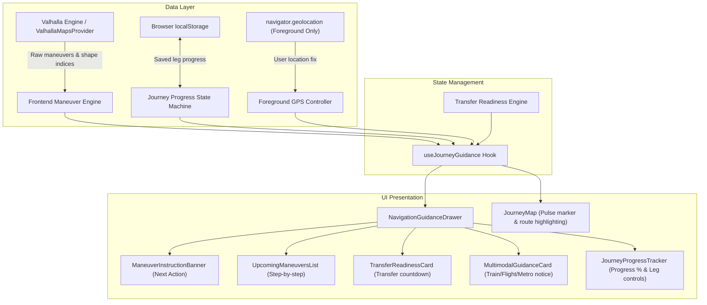
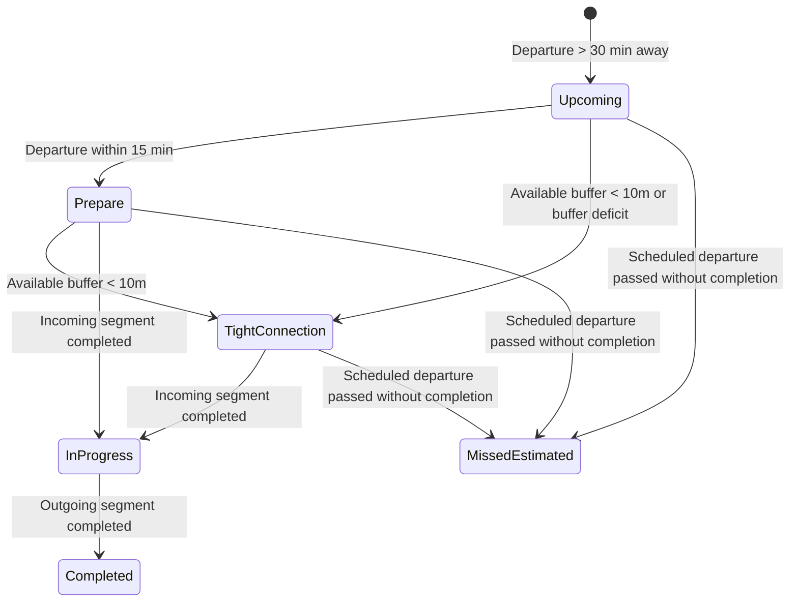

# Navigation Guidance & Journey Progress Architecture (M3.6)

## 1. Overview & Mission

KogniSync M3.6 elevates the journey experience from passive map visualization to actionable multimodal guidance and deterministic journey progress tracking:

```
Understand → Search → Compose → Optimize → Explain → Map → Guide → Track Progress → Book
```

Modern travelers in multimodal journeys (combining cabs, metros, long-distance express rail, buses, and flights) do not just need a route line on a map; they need to know:
1. **What to do right now**: The immediate next turn, highway merge, or transit check-in action.
2. **When to prepare for transfers**: Anticipating tight interchange windows and station connections before missing a train or flight.
3. **Where they stand in the overall journey**: Clear, persistent, step-by-step progress tracking across multi-leg itineraries without fabricated live telemetry.

KogniSync explicitly rejects fictional live vehicle tracking. We do not synthesize fake GPS pings for public transport or pretend to know real-time bus locations without real telemetry. Instead, we provide **deterministic, navigation-grade guidance for road legs** and **verified timetable/station transfer advisories for non-road segments**.

---

## 2. Navigation Architecture & Component Hierarchy



---

## 3. Maneuver Normalization & Provenance

### 3.1 Road Maneuver Extraction
For road segments (`driving`, `auto_rickshaw`, `taxi`, `motorcycle`, `bus_feeder`), backend maneuver extraction in `backend/app/services/maps/valhalla.py` extracts raw Valhalla route maneuvers up to 50 steps per leg.

Each maneuver retains:
- `type`: Numeric Valhalla maneuver type code (0–38).
- `instruction`: Natural language directional instruction (e.g. "Turn right onto 100 Feet Road").
- `verbal_instruction`: Spoken prompt if available.
- `street_names`: Array of street/highway names.
- `distance`: Float distance in kilometers.
- `duration`: Float duration in seconds.
- `location`: `{ latitude, longitude }` coordinate derived deterministically from the route polyline at `begin_shape_index`.
- `begin_shape_index` / `end_shape_index`: Polyline index range.

### 3.2 Action Normalization
The frontend `maneuverEngine.ts` normalizes Valhalla type codes into standard navigation actions:

| Valhalla Code | Normalized Action | Visual Icon Representation |
| :--- | :--- | :--- |
| `1`, `2`, `3` | `depart` | Upward departure arrow |
| `4`, `5`, `6` | `arrive` | Destination checkered flag / pin |
| `7`, `8` | `slight_left` | Angled up-left arrow |
| `9`, `10` | `left` | 90° left turn arrow |
| `11` | `sharp_left` | Sharp hairpin left arrow |
| `12`, `13` | `slight_right` | Angled up-right arrow |
| `14`, `15` | `right` | 90° right turn arrow |
| `16` | `sharp_right` | Sharp hairpin right arrow |
| `17`, `18` | `u_turn` | U-turn loop arrow |
| `24` | `merge` | Road merge indicator |
| `26`, `27` | `roundabout` | Roundabout circle icon |
| `Default` | `straight` | Straight continuation arrow |

### 3.3 Strict Multimodal Truth & Provenance
Non-road transit modes (**Train, Metro, Flight, Ferry**) operate under strict data provenance rules:
- **No Fabricated Road Maneuvers**: We never generate fictional road turns like "Turn left onto Train Tracks".
- **Independent Verification Mandatory**: For train, flight, and metro segments, `getSegmentGuidance()` returns `isVerifiedRoadNavigation: false` and injects verified advisory notices:
  - **Train**: Prompts passengers to verify live platform assignments and coach position on railway station indicators before boarding.
  - **Flight**: Prompts travelers to check airline terminal departure boards and security gate clearance times.
  - **Metro**: Advises passengers on platform direction, interchange stations, and token/QR validation gates.
- **Estimated Corridor Notice**: Route corridors remain explicitly marked as deterministic estimates rather than live telemetry tracks.

---

## 4. Transfer Readiness & Connection Window

Multimodal journeys succeed or fail at interchange stations. The transfer engine (`transferReadiness.ts`) computes real-time connection readiness across 7 distinct states:



### 4.1 State Definitions
1. `upcoming`: Transfer is more than 30 minutes away; connection buffer is healthy.
2. `prepare`: Incoming segment is approaching destination (within 15 minutes of transfer); passenger should collect belongings.
3. `tight_connection`: Buffer between incoming arrival and outgoing departure is less than 10 minutes (or less than recommended transfer buffer). Marked with urgent warning styling.
4. `in_progress`: User has checked off the incoming segment and is actively walking/interchanging at the station/hub.
5. `completed`: Both legs around the transfer are marked completed.
6. `missed_estimated`: Scheduled departure time has elapsed without the transfer being executed; user is advised to seek re-routing.
7. `unknown`: Missing schedule timestamps; graceful fallback without crash.

### 4.2 Midnight Boundary Handling
Timestamps are parsed with full millisecond epoch arithmetic (`outgoingDepartureMs - incomingArrivalMs`). Overnight itineraries spanning midnight (e.g., 23:45 arrival to 00:30 departure) calculate positive connection buffers (+45 min) rather than negative arithmetic errors.

---

## 5. Journey Progress State Machine & Persistence

### 5.1 Storage Architecture
Journey progress is managed client-side via `journeyProgressStore.ts` using device-local `localStorage`:
- **Isolation Key**: `kognisync_journey_progress_<journeyId>`.
- **Zero Server Drift**: User leg completions do not mutate global server inventory or require server-side session locks.
- **Auto-Recovery**: If a traveler refreshes the page or returns from offline mode, progress is reloaded seamlessly.

### 5.2 State Structure
```typescript
interface JourneyProgressState {
  journeyId: string;
  activeSegmentIndex: number;
  completedSegmentIndices: number[];
  completedManeuverIndices: Record<number, number[]>; // segmentIndex -> maneuverIndices[]
  startedAt: string;
  lastUpdatedAt: string;
  isComplete: boolean;
}
```

### 5.3 Actions Supported
- `markSegmentCompleted(segmentIndex)`: Marks a leg completed, advances active segment to next leg, updates overall percentage.
- `undoSegmentCompleted(segmentIndex)`: Reverts accidental completion, decrements progress percentage.
- `markManeuverCompleted(segmentIndex, maneuverIndex)`: Checks off individual turn instructions.
- `advanceToNextSegment()`: Transitions guidance focus to next multimodal leg.
- `clearStoredProgress(journeyId)`: Resets state to fresh start.

---

## 6. Foreground-Only GPS Controller & Privacy Boundary

### 6.1 Privacy & Lifecycle Contract
- **Foreground Only**: Location tracking executes exclusively while the user has the navigation guidance interface open.
- **Explicit Start / Stop**: Opening navigation starts `navigator.geolocation.watchPosition()`; closing navigation or unmounting the drawer immediately invokes `clearWatch()`.
- **Zero Background Tracking**: Battery-draining background workers, service worker geolocation polling, and silent coordinate exfiltration are strictly prohibited.
- **Graceful Error Handling**: Handles permission denial, timeout, and device GPS toggle smoothly without disrupting manual navigation.

### 6.2 Truth-Labeled Demo Mode
For testing and simulated demonstration (e.g., user reviewing guidance from desktop):
- `createDemoPosition(lat, lng)` generates a location state labeled `source: "simulated"` and `isDemoPosition: true`.
- The UI clearly discloses simulated status to prevent confusing users with false GPS locks.

---

## 7. Accessibility, Responsiveness & UI Layout

### 7.1 Responsive Mobile-First Design
- **Desktop**: Renders as an overlay sidebar / drawer docked directly over the journey map, preserving full map interactivity and route overview.
- **Mobile (< 768px)**: Bottom drawer with smooth peek, expand, and full view gestures. Sticky header shows current turn and progress percentage at all times.
- **Compact Viewport Guarantee**: Maneuver banner and transfer cards wrap cleanly without overflow on 360px–390px viewports.

### 7.2 Accessibility & Assistive Tech
- **ARIA Live Regions**: The active turn banner uses `aria-live="polite"` and `role="status"` to announce upcoming maneuvers to screen readers upon progression.
- **Keyboard Navigation**: All step checkoffs, next leg controls, and drawer expand/collapse toggles are fully navigable via standard keyboard focus (`Tab`, `Space`, `Enter`).
- **High-Contrast Indicators**: Turn icons and status badges meet WCAG AA contrast standards across light and dark themes.

---

## 8. Limitations & Scope Boundaries

1. **No Fictional Telemetry**: KogniSync does not fabricate live bus or train positions on map tracks. Real-time arrival delays are only displayed when provided by verified partner APIs.
2. **Turn-by-Turn Rerouting**: Dynamic off-route rerouting during driving requires continuous turn-by-turn navigation engines (e.g. Mapbox/Google Navigation SDKs) beyond the web application scope.
3. **Turn Instructions for Transit**: Public transit segments provide station interchange and boarding guidance rather than road turn maneuvers.
