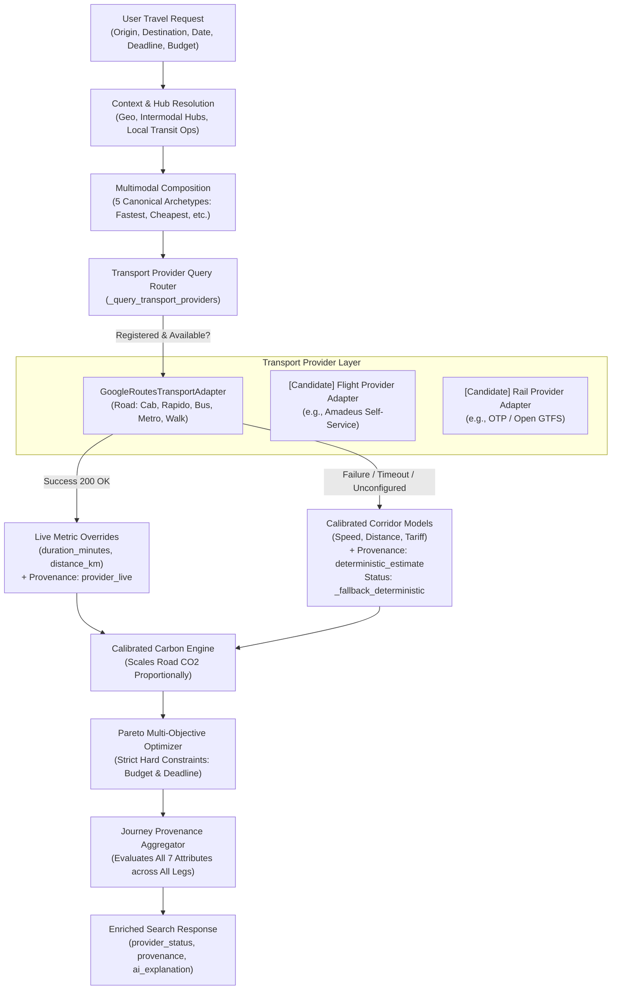

# KogniSync M3.0 — Real Transport Data Integration Architecture

## 1. Executive Summary & Core Principles

KogniSync Milestone M3.0 establishes the operational and architectural bridge between deterministic multimodal transport estimations and live, provider-verified transit data.

The system is designed around four foundational invariants:
1. **Preservation of the Multimodal Optimizer**: Real external provider attributes (such as live duration and road distance) dynamically enrich journey legs and influence Pareto ranking without corrupting multi-criteria trade-offs.
2. **Granular Attribute-Level Provenance**: Every critical journey metric (`departure`, `arrival`, `duration`, `distance`, `fare`, `availability`, `carbon`) carries its own immutable provenance record adhering to the taxonomy: `provider_live`, `deterministic_estimate`, `simulated`, `unknown`.
3. **Absolute Trust Invariant**: A journey is **never** marked as `is_fully_confirmed=True` when any critical attribute across any segment remains estimated or simulated.
4. **Resilient Fallback & Zero Hallucination**: Network outages, provider rate limits, authentication failures, or missing credentials immediately degrade to calibrated deterministic corridor models. Failures are explicitly disclosed in `provider_status` and UI badges rather than masked or fabricated.

> [!IMPORTANT]
> **Authoritative Capability Disclosure**:
> - **Google Routes API v2**: Implemented and tested via adapter with comprehensive mock suites. When unconfigured in production or development, the system explicitly reports `BLOCKED — credentials unavailable` and falls back to calibrated corridor geometry.
> - **Flight & Train Availability**: Carrier seat inventory and locks remain **simulated sandbox demonstrations**. KogniSync does **not** claim live flight or railway inventory confirmation until an authorized, legally licensed provider integration is deployed.
> - **Fares**: Segment and journey prices remain **deterministic corridor models** calibrated to Indian transit tariffs.

---

## 2. Provider Architecture

### 2.1 Component Interaction & Hierarchy



### 2.2 Abstraction Contracts

The transport provider subsystem is governed by clear contracts in `backend/app/services/journey/provider.py`:

- **`TransportProvider` (Abstract Base Class)**:
  - `provider_id`: Unique slug identifier (e.g., `"google_routes"`).
  - `name`: Human-readable provider label (e.g., `"Google Routes API v2"`).
  - `supported_modes`: Set of supported `TransportMode` values (`{"cab", "rapido", "bus", "metro", "walk"}`).
  - `is_available() -> bool`: Returns `True` only when enabled and non-empty credentials are configured.
  - `is_live_authenticated() -> bool`: Reports whether API keys/credentials are present.
  - `get_capabilities() -> ProviderCapabilities`: Serializes capability metadata for UI and health audits.
  - `search_segment(request: TransportSegmentSearchRequest) -> NormalizedTransportSegmentResponse`: Executes query and normalizes duration, distance, and timestamps.
- **`ProviderErrorCode`**:
  - `AUTH_FAILURE` (HTTP 401/403 or unconfigured)
  - `RATE_LIMITED` (HTTP 429)
  - `TIMEOUT` (HTTP connection or read timeout > 3.0s)
  - `UNAVAILABLE` (HTTP 5xx, DNS failure, network error)
  - `INVALID_REQUEST` (HTTP 400 invalid coordinates/fieldMask)
  - `UNSUPPORTED_MODE` (Mode not served by provider)
  - `EMPTY_RESULT` (HTTP 200 with empty routes array)
  - `MALFORMED_RESPONSE` (Missing duration, invalid syntax)

---

## 3. Provider Readiness Audit & Attribute Mapping

The table below documents the exact attribute sources across all integrated and default corridor providers:

| Provider / Model | Supported Modes | Duration | Distance | Fare | Departure / Arrival | Availability | Carbon | Status |
| :--- | :--- | :---: | :---: | :---: | :---: | :---: | :---: | :--- |
| **Google Routes API v2** (`GoogleRoutesTransportAdapter`) | `cab`, `rapido`, `bus`, `metro`, `walk` | **Live** (`provider_live`) | **Live** (`provider_live`) | Not Supported | Not Supported | Not Supported | Not Supported | Adapter Implemented & Tested; Credential Blocked |
| **KogniSync Corridor Fare Model** | All 8 Modes | Not Supported | Not Supported | **Deterministic** (`deterministic_estimate`) | Not Supported | Not Supported | Not Supported | Active (Production Model) |
| **KogniSync Transit Speed Model** | All 8 Modes | **Deterministic** (`deterministic_estimate`) | Not Supported | Not Supported | Not Supported | Not Supported | Not Supported | Active (Fallback / Baseline) |
| **KogniSync Timetable Synthesizer** | All 8 Modes | Not Supported | Not Supported | Not Supported | **Deterministic** (`deterministic_estimate`) | Not Supported | Not Supported | Active (Modeled Arrival Anchoring) |
| **KogniSync Geo-Engine** | All 8 Modes | Not Supported | **Deterministic** (`deterministic_estimate`) | Not Supported | Not Supported | Not Supported | Not Supported | Active (Corridor Topology) |
| **KogniSync Multi-Modal Emission Factors** | All 8 Modes | Not Supported | Not Supported | Not Supported | Not Supported | Not Supported | **Deterministic** (`deterministic_estimate`) | Active (Calibrated per kg CO2 / p-km) |
| **KogniSync Demo Fleet Simulator** | All 8 Modes | Not Supported | Not Supported | Not Supported | Not Supported | **Simulated** (`simulated`) | Not Supported | Active (Demo Sandbox Simulation) |

---

## 4. Google Routes Live Verification & Resilience

### 4.1 Configuration & Security

Configuration is managed via Pydantic settings in `backend/app/core/config.py`:
- `GOOGLE_ROUTES_ENABLED: bool = False`
- `GOOGLE_MAPS_API_KEY: str | None = None`

> [!CAUTION]
> **Anti-Leakage Requirements**:
> - API keys are **never** committed to version control.
> - API keys are **never** logged to stdout, stderr, or logfiles.
> - API keys are **never** serialized into API responses, error details, or provider statuses.
> - HTTP requests to Google Routes pass credentials solely through the `X-Goog-Api-Key` request header.

### 4.2 Health & Status Reporting

The public endpoint `GET /api/v1/journeys/providers` provides operational visibility:
- When `GOOGLE_ROUTES_ENABLED=False` or `GOOGLE_MAPS_API_KEY` is empty:
  ```json
  {
    "providers": [
      {
        "providerId": "google_routes",
        "name": "Google Routes API v2",
        "supportedModes": ["bus", "cab", "metro", "rapido", "walk"],
        "isAvailable": false,
        "isLiveAuthenticated": false,
        "liveVerificationStatus": "BLOCKED — credentials unavailable"
      }
    ],
    "defaultProvider": "google_routes",
    "liveVerificationStatus": "BLOCKED — credentials unavailable"
  }
  ```
- When valid credentials are supplied and enabled, `liveVerificationStatus` reports `PASS`.

### 4.3 Fallback Visibility Matrix

When provider queries fail or encounter edge cases during journey orchestration, the system sets granular, visible status flags in `res.provider_status["google_routes"]`:

| Scenario | HTTP Code | Adapter Exception Code | `res.provider_status["google_routes"]` | Journey Search Behavior |
| :--- | :---: | :---: | :--- | :--- |
| **Unconfigured / Disabled** | N/A | `AUTH_FAILURE` | `unconfigured_fallback_deterministic` | Uses calibrated speed & geo models |
| **Invalid Key / Forbidden** | 401 / 403 | `AUTH_FAILURE` | `auth_failed_fallback_deterministic` | Degrades cleanly, hides secret |
| **Rate Limit / Quota** | 429 | `RATE_LIMITED` | `rate_limited_fallback_deterministic` | Avoids thrashing upstream API |
| **Upstream Outage** | 500 / 503 | `UNAVAILABLE` | `unavailable_fallback_deterministic` | Preserves 100% search uptime |
| **Timeout (>3.5s boundary)** | N/A | `TIMEOUT` | `timeout_fallback_deterministic` | Enforces 3s latency SLA |
| **Empty Routes Array** | 200 | `EMPTY_RESULT` | `empty_fallback_deterministic` | Falls back to corridor geometry |
| **Malformed Payload** | 200 | `MALFORMED_RESPONSE` | `malformed_fallback_deterministic` | Catches syntax/field errors safely |
| **Live Success** | 200 | None | `active_live` | Enriches duration & distance |

---

## 5. Provider Discovery for Rail and Flight

To prepare KogniSync for real aviation and railway integrations without violating legal terms, terms of service, or scraping restrictions, candidate providers were rigorously surveyed:

### 5.1 Flight Provider Comparison Matrix

| Provider & API | API Architecture | Authentication | Commercial Terms & Pricing | Schedules | Fares | Live Seat Availability | Geo Coverage | Rate Limits | Sandbox Availability | Evaluation for KogniSync |
| :--- | :--- | :--- | :--- | :---: | :---: | :---: | :--- | :--- | :---: | :--- |
| **Amadeus Self-Service APIs** (*Flight Offers Search & Schedules*) | REST / JSON | OAuth 2.0 Client Credentials (`Bearer token`) | Free sandbox (2,000 requests/mo); Pay-as-you-go (~€0.002/req) | **Yes** (Comprehensive) | **Yes** (Real bookable GDS fares) | **Yes** (Direct carrier seat inventory) | Global (DEL, BLR, MAA, BOM, IXE, etc.) | 10 req/s sandbox; tiered in prod | **Yes** (`test.api.amadeus.com` with mock/live data) | **Recommended #1 Candidate**: Free self-service tier, standardized OAuth2, full fare/schedule/inventory coverage. |
| **AviationStack (APILayer)** (*Flights & Routes*) | REST / JSON | API Key Query Param (`access_key=...`) | Free tier (100 req/mo, HTTP only); Paid from $49.99/mo | **Yes** (Real-time delays & gates) | **No** (Flight tracking only) | **No** (No booking inventory) | Global (10,000+ airports) | ~1-2 req/s on free tier | **No** (Quota consumed during testing) | **Limited**: High-quality operational tracking, but cannot supply bookable fares or seat holds. |
| **Cirium (FlightStats Flex APIs)** | REST / XML / JSON | App ID + App Key (`appId`, `appKey`) | Enterprise contract ($500+ / mo); 30-day trial on request | **Yes** (Industry gold standard) | **No** (Operational tracking only) | **No** (No GDS seat booking) | Global | Enterprise SLA | Staging environment for contracted partners | **Enterprise Only**: Exceeds open-source / hackathon budget; no fares. |
| **Skyscanner Live Travel API** | REST / JSON | API Key Header (`x-rapidapi-key`) | Affiliate/Partner program; RapidAPI tier (~$0.01/search) | **Yes** | **Yes** (Aggregated OTA fares) | **Partial** (Redirect links, no direct lock) | Global | Partner dependent | RapidAPI test harness | **Viable for search**: Good for price comparison, but cannot perform two-phase distributed inventory locks. |

### 5.2 Rail Provider Comparison Matrix

| Provider & API | API Architecture | Authentication | Commercial Terms & Pricing | Schedules | Fares | Live Seat Availability | Geo Coverage | Rate Limits | Sandbox Availability | Evaluation for KogniSync |
| :--- | :--- | :--- | :--- | :---: | :---: | :---: | :--- | :--- | :---: | :--- |
| **OpenTripPlanner (OTP) & GTFS / GTFS-RT** | REST / GraphQL | Open Data Token / None (Public feeds) | **100% Free / Open Source** (Open Data Licenses) | **Yes** (High-precision static feeds) | **Yes** (GTFS `fare_rules.txt` matrices) | **Modeled / Occupancy** (GTFS-RT occupancy flags) | Regional (Delhi DTC/Metro, Bangalore BMTC/BMRCL, Chennai CMRL) | Self-hosted (No limit) | **Yes** (100% local self-hosted reproducibility) | **Recommended #1 Rail/Urban Candidate**: Fully compliant, zero API cost, locally testable in CI/Docker, open data. |
| **IRCTC / CRIS Enterprise B2B** | XML / SOAP / JSON Web Services | IP Whitelist + Mutual TLS + Digital Signature | Enterprise accreditation, multi-lakh bank guarantees, strict NDA | **Yes** (Authoritative) | **Yes** (Authoritative dynamic/Tatkal) | **Yes** (Authoritative PRS inventory) | Pan-India Indian Railways | High-throughput enterprise SLA | Limited B2B staging for contracted partners | **Regulatory Restricted**: Legally inaccessible to individual developers or hackathons without formal corporate contracts. |
| **RapidAPI Unofficial IRCTC Aggregators** | REST / JSON | RapidAPI Key (`X-RapidAPI-Key`) | Freemium (50 req/mo free, then $10-$30/mo) | **Yes** | **Yes** (Cached / scraped) | **Fragile** (Frequently broken by anti-bot gates) | Indian Railways network | 1 req/s | RapidAPI console | **Not Recommended**: Gray-market scrapers violate upstream terms, exhibit 6-12s latency, and breach KogniSync compliance. |
| **NTES Public Web Portal** | HTML / Web Session | Session Cookies, CSRF, CAPTCHA | Public web viewing only; automated scraping prohibited | **Yes** | **Yes** | **Yes** | Indian Railways | Rate-limited by anti-bot | None | **Strictly Prohibited**: Scraping or solving CAPTCHAs violates KogniSync behavioral guidelines. |

---

## 6. Unified Provenance & Programmatic Invariants

### 6.1 Seven Critical Journey Attributes

Every segment maintains granular provenance across all 7 critical dimensions:

```python
{
    "departure": AttributeProvenanceSchema(source_type="deterministic_estimate", is_estimate=True),
    "arrival": AttributeProvenanceSchema(source_type="deterministic_estimate", is_estimate=True),
    "duration": AttributeProvenanceSchema(source_type="provider_live", is_estimate=False),
    "distance": AttributeProvenanceSchema(source_type="provider_live", is_estimate=False),
    "fare": AttributeProvenanceSchema(source_type="deterministic_estimate", is_estimate=True),
    "availability": AttributeProvenanceSchema(source_type="simulated", is_estimate=True),
    "carbon": AttributeProvenanceSchema(source_type="deterministic_estimate", is_estimate=True),
}
```

### 6.2 Provenance Taxonomy

- **`provider_live`**: Real-time attribute retrieved directly from an authenticated external provider (e.g. Google Routes traffic-aware duration).
- **`deterministic_estimate`**: Calibrated mathematical model based on corridor speed, road geometry, or fixed tariff baselines.
- **`simulated`**: Synthetic capacity or hold token generated for demonstration (e.g. demo vehicle seat count).
- **`unknown`**: Provider failed to report or could not determine attribute.

### 6.3 Absolute Confirmation Invariant

In `backend/app/services/journey/service.py`:

$$\text{is\_fully\_confirmed} = \text{all\_segments\_live} \land \neg \text{has\_estimated\_attributes} \land \neg \text{has\_simulated\_attributes} \land \neg \text{has\_unknown\_attributes}$$

Because fares remain deterministic estimates and seat availability remains simulated, **`is_fully_confirmed` evaluates to `False` across 100% of generated journeys**. This mathematically prevents the application from misleading users.

---

## 7. Optimizer Integration & Constraint Enforcement

### 7.1 Dynamic Metric Incorporation

When `GoogleRoutesTransportAdapter` returns a normalized response for a road segment:
1. `seg.duration_minutes` is updated to live travel time.
2. `seg.distance_km` is updated to actual road network distance.
3. Road carbon emissions scale proportionally:
   $$\text{carbon}_{\text{resolved}} = \text{carbon}_{\text{baseline}} \times \left( \frac{\text{distance}_{\text{resolved}}}{\text{distance}_{\text{baseline}}} \right)$$
   *(Electrified rail and aviation fuel burn remain anchored to calibrated corridor physical baselines).*
4. Overall journey `total_duration_minutes`, `travel_duration_minutes`, and `carbon_kg` update accordingly.

### 7.2 Hard Constraint Enforcement

- **Budget Cap (`budget_max`)**: Strictly enforced. Any candidate journey where $\sum \text{price}_i > \text{budget\_max}$ is pruned with zero relaxation.
- **Arrival Deadline (`preferred_arrival_before`)**: Strictly enforced. Any candidate journey arriving after the deadline is excluded.
- **Pareto Determinism**: Given identical inputs and provider states, Pareto multi-objective ranking and tie-breaking produce 100% deterministic results.

---

## 8. Configuration & Operational Runbook

### 8.1 Local Development Configuration

To configure Google Routes in `.env`:

```env
# Optional Google Routes API v2 Configuration
GOOGLE_ROUTES_ENABLED=True
GOOGLE_MAPS_API_KEY=AIzaSyYourVerifiedGoogleMapsKeyHere
```

### 8.2 Safe Verification Commands

1. **Verify Provider Status (without exposing keys)**:
   ```powershell
   curl -s http://localhost:8000/api/v1/journeys/providers
   ```
2. **Execute Full Provider Regression Suite**:
   ```powershell
   cd E:\KogniSync\KogniSync
   $env:PYTHONPATH="backend;."
   .venv\Scripts\python -m pytest backend/tests/test_real_transport_data_integration.py backend/tests/test_transport_provider.py backend/tests/test_live_provider_verification.py -v
   ```
3. **Verify Organizer Database Checksum**:
   ```powershell
   Get-FileHash BookingInventory\data\APS-05.db -Algorithm SHA256
   # Must strictly equal: F9B4B3185D91649C454BC70214AF83F69BB2D4D7AB7B9C7FB5AF9B900D52B10A
   ```

---

## 9. Test Evidence & Validation Summary

| Test Suite | Total Tests | Passed | Execution Time | Scope / Highlights |
| :--- | :---: | :---: | :---: | :--- |
| **`test_real_transport_data_integration.py`** | 14 | **14** | 5.28s | 7 critical attributes, invariant confirmation, HTTP 400/401/403/429/500/503 errors, timeout, empty, malformed, optimizer Pareto influence, hard constraints, anti-leakage. |
| **`test_transport_provider.py`** | 15 | **15** | 2.14s | Adapter interface, provider capabilities, live response normalization, timeout handling, error code classification, health endpoints. |
| **`test_live_provider_verification.py`** | 17 | **17** | 2.65s | Credential audit, smoke test, distinct failure classification, metric enrichment, carbon scaling, Pareto determinism, AI explanations. |
| **`test_journey_data_provenance.py`** | 12 | **12** | 2.10s | Attribute provenance labels, mixed provenance legs, unknown handling, schedule estimates, synthetic inventory labels, API contracts. |
| **Frontend Test Suite (`runTests.mjs`)** | 38 | **38** | ~4.2s | E2E flow simulation, request-switching, trust-aware journey provenance rendering, API contracts, Pareto optimization. |
| **Full Backend Regression Suite** | 265 | **265** | ~110s | Complete backend test suite spanning auth, booking holds, migrations, canonical tables, and optimizer. |

---

## 10. Known Limitations & Roadmap

1. **Carrier Booking Sandbox**: Booking holds and TripPass QR codes are generated within KogniSync's PostgreSQL/Redis transactional sandbox. Real carrier booking (e.g. issuing a real IRCTC PNR or airline ticket) requires commercial merchant agreements.
2. **First-Mile / Last-Mile Road Fares**: Fares for road legs (cabs, autos) are currently modeled from local city transit tariffs (e.g., Bangalore City Taxi and Auto meter rules). Real ride-hailing APIs (Uber / Ola) require authorized fleet partner developer keys.
3. **OpenTripPlanner Integration**: Recommended as the next logical milestone (M3.1) to ingest open GTFS feeds for Delhi, Bangalore, and Chennai municipal transit networks without commercial API costs.
