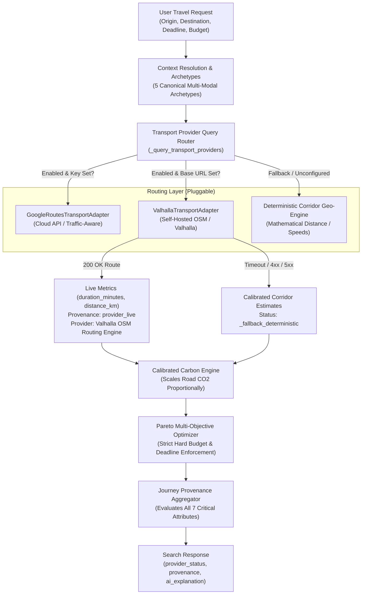

# KogniSync M3.1 — OpenStreetMap & Valhalla Routing Integration

## 1. Executive Summary & Architecture

Milestone M3.1 integrates self-hosted OpenStreetMap (OSM) routing powered by [Valhalla](https://github.com/valhalla/valhalla) into KogniSync as an independent, open-source routing engine alongside Google Routes.

The integration provides:
- **Zero Third-Party Quotas & Costs**: Local OpenStreetMap road network calculations without external API keys or cloud telemetry.
- **Pluggable & Independent Configuration**: Valhalla and Google Routes are decoupled. Either, both, or neither can be enabled.
- **Unified Provenance & Confirmation Safety**: Live Valhalla road metrics supply `provider_live` duration and distance without fabricating live fares, real schedules, or confirmed carrier inventory.
- **Conservative Docker Footprint**: Designed specifically for developer machines running Windows 11 with Docker Desktop under a 3.5 GiB memory limit.



---

## 2. Configuration Variables

All Valhalla configuration keys are declared in `backend/app/core/config.py` and exposed in `.env.example`:

| Environment Variable | Type | Default | Description |
| :--- | :---: | :---: | :--- |
| `VALHALLA_ENABLED` | `bool` | `False` | Enables Valhalla routing queries during journey orchestration. When `False`, Valhalla is bypassed. |
| `VALHALLA_BASE_URL` | `str` | `http://localhost:8002` | HTTP base URL of the running Valhalla service container. |
| `VALHALLA_TIMEOUT_SECONDS` | `float` | `3.0` | Connection and response timeout SLA boundary. Requests exceeding this boundary raise `ProviderErrorCode.TIMEOUT` and fall back cleanly. |
| `VALHALLA_PORT` | `int` | `8002` | Host port mapped to the Valhalla container in `docker-compose.yml`. |

> [!NOTE]
> `GOOGLE_ROUTES_ENABLED` and `GOOGLE_MAPS_API_KEY` remain completely separate. If both are enabled, the orchestration engine queries providers in registered sequence; if one is unavailable or times out, it gracefully cascades.

---

## 3. Local Docker Setup & Profiles

Valhalla is configured as an **optional profile** in `docker-compose.yml`. It is **never** started during default application launch (`start.bat` or `docker compose up -d`).

### 3.1 Docker Compose Definition

```yaml
  valhalla:
    profiles: ["valhalla"]
    image: ghcr.io/gis-ops/docker-valhalla/valhalla:latest
    container_name: kognisync-valhalla
    restart: unless-stopped
    ports:
      - "${VALHALLA_PORT:-8002}:8002"
    environment:
      - tile_urls=${VALHALLA_TILE_URLS:-}
      - use_tiles_ignore_pbf=${VALHALLA_USE_TILES_IGNORE_PBF:-True}
      - force_rebuild=${VALHALLA_FORCE_REBUILD:-False}
      - build_elevation=False
      - build_admins=False
      - build_time_zones=False
      - server_threads=2
    volumes:
      - valhalla_data:/custom_files
    healthcheck:
      test: ["CMD-SHELL", "curl -f http://localhost:8002/status || exit 1"]
      interval: 10s
      timeout: 5s
      retries: 5
      start_period: 20s
```

### 3.2 Starting and Stopping Valhalla

- **Start Valhalla container**:
  ```powershell
  docker compose --profile valhalla up -d valhalla
  ```
- **Stop Valhalla container**:
  ```powershell
  docker compose --profile valhalla stop valhalla
  ```
- **Inspect Valhalla container logs**:
  ```powershell
  docker compose logs -f valhalla
  ```

---

## 4. OpenStreetMap Extract Acquisition & Import Procedure

To keep the development footprint conservative and prevent memory exhaustion on Windows 11 Docker Desktop (3.5 GiB RAM allocation):

> [!WARNING]
> **Never download a planet-wide OSM extract automatically**. Planet extracts exceed 70 GB compressed and require 64+ GB RAM to build routing tiles.

### 4.1 Recommended Regional Extracts

For local hackathons and corridor verification, download small regional extracts from [Geofabrik](https://download.geofabrik.de/asia/india.html):
- **Southern India extract** (`southern-zone-latest.osm.pbf`, ~300 MB)
- Or a city/metro bounding box extract (e.g. Bangalore or Chennai bounding box ~25–50 MB via [BBBike.org](https://extract.bbbike.org/)).

### 4.2 One-Time Import Steps

1. Create a local staging directory for your PBF file (or copy directly into the `valhalla_data` volume):
   ```powershell
   # Example: Download small Karnataka / Bangalore extract
   curl -O https://download.geofabrik.de/asia/india/southern-zone-latest.osm.pbf
   ```
2. Place the `.osm.pbf` file into the container's volume:
   ```powershell
   docker cp southern-zone-latest.osm.pbf kognisync-valhalla:/custom_files/
   ```
3. Start the build process with `use_tiles_ignore_pbf=False`:
   ```powershell
   docker compose --profile valhalla up -d valhalla
   ```
4. Once tile generation completes (tiles stored in `/custom_files/valhalla_tiles`), the container automatically serves the routing HTTP API on port 8002.

---

## 5. Resource Requirements

| Resource | Recommended Limit | Safe Minimum | Notes |
| :--- | :---: | :---: | :--- |
| **Docker RAM** | 3.5 GiB | 2.0 GiB | `build_elevation=False` and `build_admins=False` avoid high memory overhead during tile generation. |
| **Disk Storage** | 5.0 GB | 1.5 GB | Tile cache for regional Southern India extract occupies ~800 MB in `valhalla_data`. |
| **CPU Threads** | 2 cores | 1 core | Configured via `server_threads=2`. |
| **Build Time** | ~10–15 min | ~3 min (city bbox) | One-time build; subsequent restarts are instant because `use_tiles_ignore_pbf=True`. |

---

## 6. Supported Routing Modes

The `ValhallaTransportAdapter` maps internal transport modes into Valhalla costing models:

| Internal Mode (`TransportMode`) | Valhalla Costing Profile | Description |
| :--- | :--- | :--- |
| **`cab`** | `auto` | Automobile road network routing with standard speed limits. |
| **`auto`** | `auto` | Auto-rickshaw urban road network routing. |
| **`bus`** | `auto` | Bus feeder road network routing. |
| **`rapido`** | `motorcycle` | Two-wheeler motorcycle routing via OSM road corridors. |
| **`walk`** | `pedestrian` | Pedestrian footpaths, sidewalks, and crosswalks. |
| **`flight`**, **`train`**, **`metro`** | *Rejected* | Explicitly raises `ProviderErrorCode.UNSUPPORTED_MODE`; handled by scheduled corridor transit models. |

---

## 7. Data Provenance & Safety Model

When a Valhalla route is resolved:
- **`duration`**: Labeled `provider_live` (`is_estimate: False`, `provider_name: "Valhalla OSM Routing Engine"`).
- **`distance`**: Labeled `provider_live` (`is_estimate: False`, `provider_name: "Valhalla OSM Routing Engine"`).
- **`fare`**: Remains `deterministic_estimate` (derived from KogniSync corridor tariff model).
- **`availability`**: Remains `simulated` (unverified demo fleet capacity).
- **`carbon`**: Remains `deterministic_estimate` (scaled proportionally to actual road distance: $\text{carbon} = \text{carbon}_{\text{base}} \times \frac{\text{dist}}{\text{dist}_{\text{base}}}$).
- **`is_fully_confirmed`**: Strictly evaluates to **`False`**.

> [!CAUTION]
> **Trust Invariant**: A journey is **never** presented as fully confirmed based on live road routing alone. Fares and carrier seat inventory must be explicitly disclosed as unconfirmed.

---

## 8. Failure and Fallback Behavior

If Valhalla is disabled, stopped, or times out:

| Failure Mode | Status Code in `provider_status["valhalla"]` | Behavior |
| :--- | :--- | :--- |
| **Unconfigured / Disabled** | `unconfigured_fallback_deterministic` | Degrades immediately to calibrated corridor transit speed and coordinate geometry. |
| **Container Stopped / Network Error** | `unavailable_fallback_deterministic` | Journey search succeeds with deterministic estimates without raising HTTP 500. |
| **Request Timeout (>3.0s)** | `timeout_fallback_deterministic` | Bounded SLA protects user latency. |
| **No Route Found (Error 170)** | `empty_fallback_deterministic` | Degrades to geographic distance baseline. |
| **Invalid Lat/Lng (400)** | `invalid_request_fallback_deterministic` | Absorbed cleanly with corridor fallback. |

---

## 9. Verification Runbook

### 9.1 How to Verify Against Real Valhalla Service

1. Verify container status and health:
   ```powershell
   curl -s http://localhost:8002/status
   ```
   *Expected response*: `{"version": "...", "tileset_last_modified": ...}`
2. Execute a test routing query:
   ```powershell
   curl -s -X POST http://localhost:8002/route `
     -H "Content-Type: application/json" `
     -d '{"locations":[{"lat":12.978,"lon":77.572},{"lat":12.845,"lon":77.660}],"costing":"auto","directions_options":{"units":"kilometers"}}'
   ```
   *Expected response*: Valid JSON containing `trip.summary.time` and `trip.summary.length`.
3. Enable in `.env`:
   ```env
   VALHALLA_ENABLED=True
   VALHALLA_BASE_URL=http://localhost:8002
   ```
4. Query the KogniSync provider health endpoint:
   ```powershell
   curl -s http://localhost:8000/api/v1/journeys/providers
   ```

### 9.2 How to Disable Valhalla and Return to Deterministic Fallback

1. In `.env`:
   ```env
   VALHALLA_ENABLED=False
   ```
2. Stop the container (optional):
   ```powershell
   docker compose --profile valhalla stop valhalla
   ```

---

## 10. Demo Capability Matrix (Authoritative Transparency)

| Capability Dimension | Production Claim | Actual System Behavior |
| :--- | :---: | :--- |
| **Road Routing & Distance** | **Live** (when Valhalla or Google Routes active) | Verified against live road network topology (OSM / Google Routes). |
| **Road Traffic Congestion** | **Estimated** | Historical corridor speed factors or static OSM maxspeed tags. |
| **Transit Fares** | **Estimated** | Calibrated deterministic corridor tariffs (e.g. Bangalore taxi meter / Indian Railways rate slabs). |
| **Train Timetables** | **Estimated** | Calibrated timetable synthesizer anchored backward from arrival deadline. |
| **Flight Availability** | **Simulated** | Synthetic seat count (`is_real_inventory: False`). |
| **Train Availability** | **Simulated** | Synthetic seat count (`is_real_inventory: False`). |
| **Booking & Payment** | **Sandbox Simulation** | Concurrency-safe Redis hold and PostgreSQL booking record without live payment gateway charge. |

---

## 11. Known Limitations

1. **Static OSM Speeds**: Valhalla routes using OpenStreetMap roadway classifications (`motorway`, `primary`, `residential`) and tagged speed limits. Real-time traffic jams require real-time probe feeds (e.g. OpenLR/TPEG), which are not included in static extracts.
2. **Pedestrian Routing across Expressways**: Certain Indian highway corridors lack complete pedestrian sidewalk tagging in OSM. Pedestrian segments are restricted to first/last mile access hubs.
3. **Turn-by-Turn Instruction Audio**: Valhalla generates narrative turn-by-turn maneuvers, but KogniSync's current UI consumes aggregate segment metrics (`duration`, `distance`, `coordinates`). Turn-by-turn voice prompts are out of scope for M3.1.

