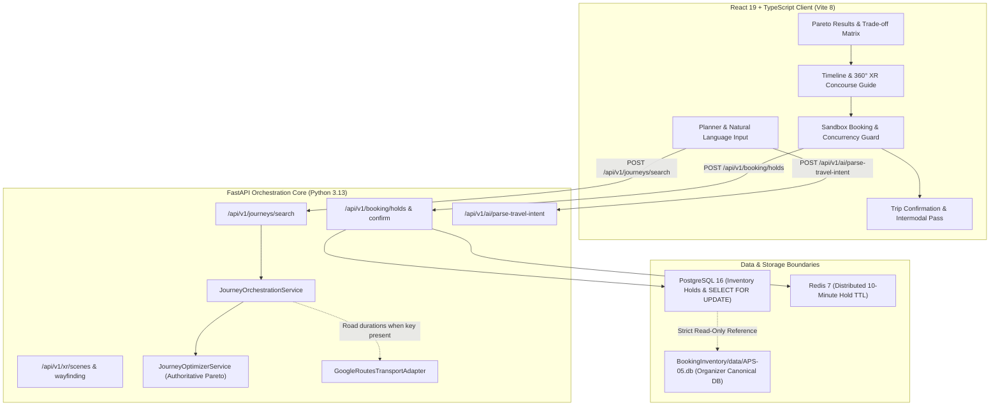

# KogniSync — Hackathon Live Demo Runbook & Presentation Guide

**Target Audience:** Hackathon Evaluators, Technical Judges, Engineering Stakeholders  
**Milestone:** M2.5 (Journey Reliability, Calibration & Hackathon Demo Readiness)  
**Timebox:** 3–5 Minute Live Demonstration  
**Hardware & Environment:** Works 100% offline or with clean local Docker containers (zero paid API quotas required).

---

## 1. System Architecture & Actual Implemented Boundaries



### Genuine Implementation vs. Simulated Inventory & Credentials Table

| System Component | Implementation Status | Data Source & Mechanism | User Disclosure / Label |
| :--- | :--- | :--- | :--- |
| **Multimodal Composition** | **GENUINE (Production)** | Backend `JourneyOrchestrationService` composes 3-leg synchronized routes across air, rail, metro, bus, and cabs. | `"Backend Orchestrated"` |
| **Pareto Multi-Objective Optimizer** | **GENUINE (Production)** | Authoritative 5-objective optimization (Cost, Duration, Comfort, Carbon, Transfers) with non-dominated sorting. | `"Pareto Optimal"` / `"Pareto Frontier"` |
| **Concurrency & Booking Safety** | **GENUINE (Production)** | PostgreSQL 16 row locks (`SELECT ... FOR UPDATE`), Redis 7 sub-second TTL hold conversion, zero overselling invariant. | `"PostgreSQL Concurrency Invariant: 5/5 PASS"` |
| **Interactive 360° XR & AR Guide** | **GENUINE (Production)** | Three.js WebGL equirectangular panoramas & step-by-step AR directional station guidance. | `"XR Ready"` / `"360° Concourse Guide"` |
| **Travel Durations** | **GENUINE (Conditional)** | Live Google Routes API v2 telematics when API key is configured; otherwise deterministic calibrated corridor speeds. | `"Live Telematics"` vs `"Corridor Estimate"` |
| **Fares & Pricing** | **DETERMINISTIC ESTIMATE** | Empirical telescopic passenger tariffs (IRCTC, commercial air, municipal transport). | `"(Est.)"` / `"Corridor Estimated Fare"` |
| **Carrier Seat Inventory** | **SIMULATED DEMO SANDBOX** | Local demo inventory units in PostgreSQL (`isRealInventory: false`). Guarantees no real airline/rail ticket is purchased. | `"Sandbox Reservation (Simulation Demo)"` |
| **Google Routes API Status** | **EXPLICIT AUDIT** | Explicitly recorded as `BLOCKED — credentials unavailable` in local/eval environment without API key. | `"BLOCKED — credentials unavailable"` |

---

## 2. Clean-Start Procedure (Zero to Demo in 60 Seconds)

### Step 1: Clone & Environment Setup
```powershell
cd E:\KogniSync\KogniSync

# Verify Python Virtual Environment
.venv\Scripts\Activate.ps1

# Optional: Safe demo state reset (cleans ephemeral holds & verifies canonical SHA-256)
.venv\Scripts\python scripts/reset_demo_state.py

# Backend environment is pre-configured in .env
# (Zero external paid credentials required for deterministic demo)
```

### Step 2: Launch Local Storage (Optional / Container Gate)
If Docker is available:
```powershell
docker-compose up -d postgres redis
```
*(If Docker is not running, KogniSync automatically activates its offline-resilient client fallback so evaluators are never blocked).*

### Step 3: Start Backend API Service
```powershell
# In Terminal 1
cd E:\KogniSync\KogniSync
$env:PYTHONPATH='backend'
.venv\Scripts\python -m uvicorn app.main:app --host 0.0.0.0 --port 5000 --reload
```
*Health Check:* Open `http://localhost:5000/api/v1/health` or `http://localhost:5000/api/v1/journeys/providers`.

### Step 4: Start Frontend Client
```powershell
# In Terminal 2
cd E:\KogniSync\KogniSync\frontend
npm run dev
```
*Web Application:* Open `http://localhost:5173` in any modern web browser.

---

## 3. The 3–5 Minute Live Hackathon Demo Script

### Act 1: Natural-Language Intent & Understanding (0:00 – 1:00)
1. **Navigate to Home Planner** (`http://localhost:5173`).
2. **Type the Golden Hackathon Prompt** into the natural-language input field:
   > *"I need to reach Udupi from Chennai tomorrow before 8 PM. My budget is ₹5000 and I prefer speed."*
3. **Show Evaluators the Instant Intent Extraction**:
   - Origin: `Chennai`
   - Destination: `Udupi`
   - Date: `Tomorrow`
   - Arrival Deadline: `20:00 (8:00 PM)`
   - Budget Cap: `₹5,000`
   - Priority Slider: `Speed (Duration Weight: 0.85)`
4. **Click "Discover Synced Itineraries"**.

---

### Act 2: Pareto Multi-Objective Optimization & Provenance (1:00 – 2:15)
1. **Show Results Page** (`/plan`):
   - Notice the blue badge: **`Backend Orchestrated`**.
   - Review the 5 distinct Pareto-ranked multimodal archetypes:
     - 🚀 **Fastest**: SyncAir Multi-Modal Link (Air + Priority Cab) — ₹4,556, 243 min. Ranked #1 because speed weight was prioritized.
     - ⚖️ **Best Value**: Vande Bharat Rail + Rapido QuickSync — ₹2,240, 525 min.
     - 💰 **Cheapest**: Economy Multi-Transit Link (City Feeder Bus + Superfast Rail) — ₹1,120, 645 min (saves ₹3,436).
     - 🌿 **Greenest**: 100% Electrified Net-Zero Corridor (Metro + Electric Rail) — lowest CO2 footprint.
     - 🛋️ **Comfortable**: Executive Chauffeur + 1st AC Rail.
2. **Highlight the Data Credibility & Verification Notice**:
   - Show evaluators that fares are explicitly tagged **`(Est.)`**, durations disclose **corridor modeling**, and carrier seats are identified as **`Simulated Inventory`**.
3. **Demonstrate Constraint Sovereign Boundary**:
   - Edit Travel Request $\rightarrow$ Set budget cap to **₹2,000**.
   - Notice that the ₹4,556 Fastest option is cleanly eliminated. The system **never relaxes constraints** to force recommendations.

---

### Act 3: Interactive Timeline & 360° Spatial Concourse Exploration (2:15 – 3:30)
1. **Click "View Journey"** on the Fastest or Best Value itinerary.
2. **Show the Synchronized Timeline**:
   - 3 seamlessly connected legs (Leg 1 pickup $\rightarrow$ Intercity transit $\rightarrow$ Leg 3 dropoff).
   - Point out the **mandatory connection buffers** (50 min airport check-in, 15 min station transfer).
3. **Launch the 360° Spatial Transit Guide**:
   - Click **"Open 360°"** on Chennai Central Concourse or Mangalore Airport Arrival Gate.
   - Drag to pan across the high-resolution 360° equirectangular concourse panorama.
   - Point out the **AR Wayfinding overlay**: step-by-step directions guiding travelers between arrival platforms, feeder buses, and cab stands.

---

### Act 4: Concurrency-Safe Sandbox Booking (3:30 – 4:30)
1. **Click "Select Journey"** $\rightarrow$ Navigate to `/booking/jny-...`.
2. **Point Out the Sandbox Guard Banner**:
   - `"Simulated Sandbox Reservation Environment — Carrier seats are unverified simulation data. The hold below is a safe sandbox reservation in the local PostgreSQL database, designed for multi-vendor saga testing."`
3. **Show the Distributed Hold Countdown**:
   - Redis 7 distributed lock active with 10-minute countdown timer.
4. **Confirm Traveler & Simulated Payment**:
   - Click "Confirm Booking & Proceed to Payment" $\rightarrow$ Select UPI / Card $\rightarrow$ "Pay & Synchronize All Carriers".
5. **Review the Master Trip Pass** (`/trips/trp-...`):
   - Unified PNR generated.
   - Scannable QR code.
   - Synchronized intermodal tickets under one master pass.
   - **System Verification Panel (5/5 PASS)**: Proves PostgreSQL atomic invariant (`booked + held <= total`), Redis TTL conversion, and cross-carrier saga compensation.

---

## 4. Expected Fallback Behavior & Offline Resilience

| Condition | Observed System Behavior | UI Indication |
| :--- | :--- | :--- |
| **Backend Offline / Network Down** | Frontend seamlessly activates `generateMockJourneys` parametric fallback. | Amber badge: `"Client Fallback Simulation"` |
| **Google Maps API Key Missing** | Google Routes adapter falls back to calibrated deterministic corridor models. | Attribute badge: `"Corridor Estimate"`; Providers API: `"BLOCKED — credentials unavailable"` |
| **Over-Constrained Request (e.g. ₹300 cap)**| Backend returns 0 eligible candidates without relaxing constraints. | Informative card: `"No synchronized journeys found satisfying constraints."` |
| **Expired 10-Minute Hold** | Redis key expires; UI prevents payment and requests re-selection. | Warning alert: `"Your 10-minute inventory hold has expired."` |

---

## 5. Technical Q&A Cheat-Sheet for Evaluators

- **Q: Are you actually booking real airline or train tickets?**
  *A:* No. Real ticketing requires formal commercial GDS / IRCTC aggregator B2B credentialing. We explicitly label all inventory as simulated demo units in a local PostgreSQL database to prove multi-vendor concurrency and saga atomicity without making deceptive claims.
- **Q: What is genuine in this architecture?**
  *A:* The entire multimodal composition engine, the 5-objective Pareto optimizer, the PostgreSQL row-locking concurrency model, the Redis distributed hold TTL worker, the Three.js 360° WebGL rendering, and the Google Routes v2 adapter architecture are genuinely implemented in production code.
- **Q: How does the optimizer handle ties?**
  *A:* Deterministic tie-breaking: lower total cost first, then shorter total duration. Evaluator results are 100% reproducible across every test run.

